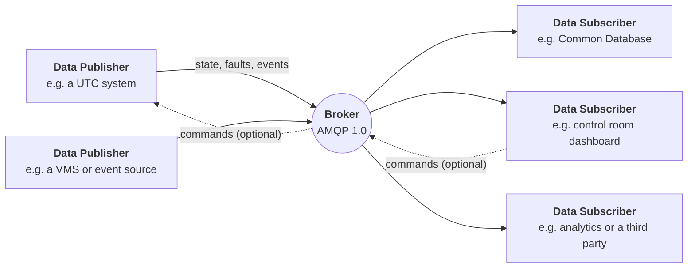

# TOPAS 3000A Procurement Buyer's Guide

**For:** local authority officers who specify, tender for and accept urban traffic control (UTC) and traffic management systems.
**Covers:** specifying TOPAS 3000A compliant solutions for new UTC systems, and for the now superseded UTMC systems you may be replacing or keeping alive.
**Terms:** unfamiliar words are defined in the [Key terms](#appendix-key-terms) appendix at the end.
**Status:** This guide helps you write a requirement. It is not part of the specification, it is not legal or commercial advice, and where it differs from `README.md` (the specification) the specification prevails.

---

## 1. The short version

- TOPAS 3000A is the successor to the UTMC standards. It replaces the old CORBA interface with a modern, secure, publish-and-subscribe interface that carries JSON messages over AMQP 1.0.
- **A UTC system can provide TOPAS 3000A itself.** TOPAS 3000A is an interface, not a product. A UTC system that implements the Data Publisher role publishes TOPAS 3000A data directly, with no separate "TOPAS 3000A system" in front of it. The only extra component is the Broker, which is ordinary messaging infrastructure and can come from the UTC supplier (Section 2.1).
- It is **not** backwards compatible with UTMC. A UTMC system and a TOPAS 3000A system do not talk to each other without a translation gateway.
- Your tender should ask for **conformance to named parts of the specification**, not for "TOPAS 3000A compatible" in general. Section 5 gives clause wording you can paste.
- **TOPAS will certify conformance.** Certification is performed by TOPAS, so your contract should require it (C10.4). The specification itself does not yet describe the certification process, and it still makes conformance testing the supplier's responsibility, so check with TOPAS what is available for the version you are specifying. Certification does not replace your own acceptance test: your contract must make the supplier *show* conformance, and you should test it yourself before you accept. Section 7 explains how.
- Decide first what you actually need: which data, who publishes it, who receives it, and whether anyone may send commands. Section 4 is a checklist.

---

## 2. TOPAS 3000A in plain terms

Systems no longer connect to each other point to point. Everything goes through a **Broker**, a message-passing service that you can think of as a post office with sorted pigeonholes.

| Role | What it is | Who typically supplies it |
|------|------------|---------------------------|
| **Data Publisher** | Any system that publishes TOPAS 3000A data. A UTC system is the most common one, but a VMS, a traffic event source or a weather station is the same role. | The system supplier |
| **Broker** | The AMQP 1.0 message service in the middle. It is infrastructure, not a traffic management product. | You, a supplier, or a hosting provider |
| **Data Subscriber** | Any system that consumes the data: the UTMC Common Database, a dashboard, an analytics platform, a third-party application. | The system supplier, or you |

**What this means for you:**

- Publishers and subscribers no longer need to know about each other. A new subscriber can be added without touching the UTC system, so a second supplier can receive the same data without a new interface being built.
- A subscriber being slow or broken must not affect the publisher. The specification says data export MUST NOT degrade real-time control (AC6-4).
- Each *domain* of data has its own message types and channels (Section 3).

The specification is published with machine-readable definitions (JSON Schemas and an AsyncAPI document), so "does this message conform?" has a mechanical answer. A supplier cannot argue about what a field means; they can be tested against the schema.

### 2.1 A UTC system is itself the Data Publisher

TOPAS 3000A describes **what a system says and how it says it**. It does not describe a box you buy and put in front of your UTC system.

- **The UTC system publishes directly.** The specification defines the Data Publisher as "any system publishing TOPAS 3000A conformant data" and names a UTC system as the most common example. A UTC system that implements the interface natively takes its own state, faults and events and publishes them as TOPAS 3000A messages. Nothing sits between the UTC system and the Broker.
- **It can subscribe too.** The same system can be a Data Subscriber if you want it to receive data or commands from other systems.
- **The Broker is the only additional component.** Every deployment needs one, because it carries the messages. It is infrastructure, not a traffic management product. In the specification's model **the Data Publisher provides the Broker** and manages the certificate authority that issues client certificates to subscribers, so for a UTC system the UTC supplier supplies, hosts and supports it as part of their offer. The specification does not mandate a product (any AMQP 1.0 broker that meets Section 5.3 will do). If you would rather run the Broker yourself, or have a hosting provider run it, say so in the tender; it is a departure from the default and the responsibilities for certificates and support must be written down.
- **A separate TOPAS 3000A converter is only needed for a system that cannot publish natively.** That is a legacy UTMC system, or a UTC system whose supplier has not implemented the interface. In that case you are buying a gateway (Section 6.3, option B), and it should be a visible, priced line in the bid with its own support and end date.

**What this means in a tender:**

| You should expect | You should not accept |
|---|---|
| The UTC supplier states that the UTC system implements the Data Publisher role itself, and provides the Broker. | A "TOPAS 3000A module" or "interface server" sold as a separate product, licence or service for a capability the UTC system should have. |
| Any Broker is listed as a component, with who supplies it, who supports it and what it costs. | A Broker or adapter that appears only in the technical annex and not in the price schedule. |
| Support for the interface sits under the UTC supplier's contract and conformance obligations. | The interface being supported by a third party the UTC supplier does not answer for. |

Clauses C1.5 to C1.7 put this into the requirement.

---

## 3. What data is covered

### 3.1 Available now

These domains are defined, have published schemas and SDKs, and can be specified today:

| Domain | Typical content |
|--------|-----------------|
| **Traffic signal** | Definitions, configuration, plan and stage state, faults, history, commands |
| **Detector** | Definitions, flow, occupancy, speed and headway measurements, faults |
| **Transport link** | Link definitions and live link state (SCOOT, GPS and ANPR-derived data) |
| **Transport route** | Routes and route status |
| **Network** | Nodes, links, paths, zones and turns (the geography the others refer to) |
| **VMS** | Sign definitions, status, display commands |
| **Traffic event** | Accidents, incidents, roadworks, planned events |
| **Strategy** | Strategy definitions, status and trigger commands |

Faults are common to the device domains. A fault's meaning comes from a **fault type catalogue** rather than a fixed list, so a supplier can add fault types without a change to the standard.

### 3.2 Defined but not yet in scope

Access control, air quality (including the enhanced set), car parks, CCTV and meteorological data are modelled but deliberately held back until a later phase. **Do not write a TOPAS 3000A conformance requirement for these domains yet.** If you need them, ask for them as a named extension and say that you expect to move to the standard definitions when they are published (AC3, AC8-1).

### 3.3 Not covered

- **Historical data.** Publishers publish current state and events as they happen and are not required to store previous states. If you need history, buy it explicitly, for example as a subscriber that stores what it receives.
- **Quantised and prediction data** are not yet defined.
- **A capability declaration** (a way for a subscriber to ask which commands a system supports) is not yet defined. The specification records this as open.

---

## 4. Decide these before you write the specification

Work through this checklist with your technical and operational colleagues. Every "yes" below becomes a requirement in Section 5.

| # | Question | Why it matters |
|---|----------|----------------|
| 1 | Which domains do you need (3.1)? | You only pay for, and test, what you ask for. |
| 2 | Which systems must **publish**? Which must **subscribe**? | A UTC system is usually a publisher. Your Common Database, dashboard or analytics are usually subscribers. |
| 3 | **Who runs the Broker**, and where does it sit (your network, the supplier's, a cloud provider's)? | The specification's default is that the Data Publisher provides it and manages its certificates. The Broker carries every system's data and credentials, so put its ownership and support in the contract. |
| 4 | Is the interface **read-only**, or may a subscriber send commands to a publisher (set a plan, force or hold a stage, change a sign)? | Commands change what happens on the road. They carry the highest risk and need their own clauses (5.7). |
| 5 | How big is the estate? Number of signals, detectors, links, signs. | The specification sets a floor of 10,000 definitions per object type and 100,000 objects in aggregate. If you are larger or expect to grow, say so. |
| 6 | Do you need **history**? For how long? | Not provided by the interface (3.3). |
| 7 | Are you keeping a **UTMC system** alive for now? | Then you need the migration approach in Section 6. |
| 8 | Do you depend on **vendor-specific data**? | Allowed as documented extensions, but it must not be needed for core function (5.9). |
| 9 | What is your **time zone** and how do you treat clock changes? | Required in every deployment (5.8). |

---

## 5. Requirement wording you can use

Each clause is written in the same MUST/SHOULD language as the specification (BCP 14), so a supplier's response can be checked against the source. Square brackets mark values you must fill in. The "Spec" line names the part of `README.md` (the specification) the clause comes from; quote it in the tender so the supplier cannot read a different standard into it.

Use the clauses you need. Do not weaken a MUST to a SHOULD without understanding what you give up.

### 5.1 Conformance and versions

> **C1.1** The Supplier's [system] MUST conform to the TOPAS 3000A specification, version [state the version and date you are specifying], for the following domains and roles: [list domain and role: Data Publisher / Data Subscriber].
>
> **C1.2** Conformance means that every message the system publishes validates against the published JSON Schema for its channel, and that every message it consumes is handled as the specification requires.
>
> **C1.3** The Supplier MUST state which schema version their system implements, and MUST notify the Authority [N] months before changing it.
>
> **C1.4** Where the Supplier does not implement an optional element, they MUST list it in their response (see C10.1).
>
> **C1.5** The Supplier's UTC system MUST itself implement the TOPAS 3000A Data Publisher role [and, where required, the Data Subscriber role] for the domains in C1.1, and MUST publish directly to the Broker. The Authority is not required to buy a separate TOPAS 3000A product, licence or middleware for the UTC system to publish or receive TOPAS 3000A data.
>
> **C1.6** Where the Supplier's solution includes any additional component between the UTC system and the Broker (an adapter, gateway, interface server or similar), the response MUST identify it, state who supplies and supports it, and show its price as a separate line. Such a component MUST be covered by the conformance statement (C10.1) and the acceptance tests (Section 7.4) in the same way as the UTC system.
>
> **C1.7** The Supplier MUST provide the Broker, manage the certificate authority and issue client certificates to Data Subscribers, and MUST give Data Subscribers the connection details, TLS configuration, channel naming conventions and AsyncAPI document they need. [Alternative where the Authority or a hosting provider runs the Broker: the Authority will provide the Broker; the Supplier MUST connect to it and conform to C2.1 to C2.4 and C3.1 to C3.3, and the responsibility for certificate issue and Broker support is: [state it].] A Broker provided under either option MUST meet C3.1 and C3.2.

*Spec: Source of truth; Acceptance Criteria; Requirements Notation.* Check the current version with the specification's maintainers before you tender. The schemas are versioned (`-v1.0`), and you want the contract to name the one you mean.

### 5.2 Transport and security

> **C2.1** All communication between the system and the Broker MUST use TLS 1.3. Earlier versions MUST NOT be offered or accepted.
>
> **C2.2** Connections MUST use mutual TLS: the system authenticates to the Broker with an X.509 client certificate, and the Broker authenticates to the system.
>
> **C2.3** The solution MUST NOT require a VPN.
>
> **C2.4** The Supplier MUST document how certificates are issued, renewed and revoked, and MUST NOT use shared credentials between systems.

*Spec: AC5, AC5-1, AC5-2, AC5-4; Security.*

### 5.3 The Broker

If you are buying or hosting the Broker, or requiring a supplier to be compatible with yours:

> **C3.1** The Broker MUST support AMQP 1.0, TLS 1.3 (refusing earlier versions), X.509 client certificates, publish-subscribe, message acknowledgement, at-least-once delivery, multiple concurrent subscribers per channel, and unmodified JSON payloads.
>
> **C3.2** The Broker SHOULD persist messages to disk, keep queues across a restart, and retain messages for at least 24 hours (7 days for definition, configuration and fault messages).
>
> **C3.3** The Broker SHOULD expose queue depth, message rate and retention metrics to the Authority.

The specification names no Broker product and is deliberately broker-agnostic. You can choose any AMQP 1.0 broker that meets these requirements. *Spec: AMQP Broker Requirements; Message Retention and Durability.*

### 5.4 Scale and performance

> **C4.1** The system MUST support at least [10,000, or your own larger number] definitions per object type and [100,000, or your own number] objects in aggregate.
>
> **C4.2** Publishing data to subscribers MUST NOT degrade the system's real-time control performance at that scale.
>
> **C4.3** Adding a subscriber MUST NOT change the load on, or the behaviour of, the publisher.

*Spec: AC6 to AC6-4.* The first two numbers are the minimum floor, not a target. Ask the supplier to say what they have actually tested at, and ask for the result.

### 5.5 Publisher behaviour (UTC systems and other data sources)

> **C5.1** The system MUST publish every message with a timestamp recording when the data was generated, and MUST identify each message by its channel and schema version.
>
> **C5.2** The system MUST support the `sync-request` channel so that a subscriber can obtain the current state without waiting for changes, and MUST send the reply only to the requester.
>
> **C5.3** The system MUST remain able to publish the current state of any object it publishes, on request, even if the message that established it was sent long ago.
>
> **C5.4** The system SHOULD rate-limit sync requests so that they cannot degrade real-time control.

*Spec: Data Model; Message Timeliness and Staleness; State Synchronization; Historical Data Responsibility.*

### 5.6 Subscriber behaviour (Common Database, dashboards, analytics)

> **C6.1** The system MUST check the timestamp of every message against the timeliness stated for it, and MUST NOT use stale data for a critical operation such as a strategy decision or a real-time display.
>
> **C6.2** The system MUST reconnect automatically after a connection failure and MUST NOT assume the Broker is available.
>
> **C6.3** The system MUST discard a message that is not valid JSON or does not validate against its schema, and MUST continue with the messages that follow.
>
> **C6.4** The system MUST ignore a message type it does not recognise, so that a later addition to the standard does not stop it working.
>
> **C6.5** The system MUST NOT block the Broker. If it cannot keep up, it handles that locally.
>
> **C6.6** If it has been disconnected for longer than the Broker's retention period, the system MUST request a full state synchronisation.
>
> **C6.7** The system SHOULD deduplicate messages (delivery is at least once) and SHOULD alert an operator when expected data stops arriving.

*Spec: AC7 to AC7-3; Message Timeliness and Staleness; Error Handling for Subscribers; Message Retention and Durability.*

### 5.7 Commands (only if a subscriber may control equipment)

Commands are optional in the standard. A publisher that does not support a command is still conformant. You decide what *you* require.

> **C7.1** The Supplier MUST list which command types the system supports (for a traffic signal: `setPlan`, `forceStage`, `holdStage`, `synchronizeClock`, `requestStatus`) and which it does not.
>
> **C7.2** The system MUST answer a command it does not support with `notSupported`. It MUST NOT stay silent, report `invalid` or report `failed`.
>
> **C7.3** Commands that change the state of equipment on the road (force stage, hold stage and similar) SHOULD be disabled by default and enabled only where the Authority has asked for them and has an authorisation model in place.
>
> **C7.4** Every command MUST be answered on the requester's own reply address, with the command's correlation identifier carried through to every response.
>
> **C7.5** Re-sending a command with the same correlation identifier MUST NOT run it twice; the system MUST return the stored result.
>
> **C7.6** Where the identity of the requester affects what a command does, or is recorded in an audit trail, the Supplier MUST demonstrate that the identity comes from the authenticated messaging context and cannot be chosen by the sender. A field the sender can set (such as the `x-originator` header, or an AMQP `user-id`) is not sufficient.

*Spec: Command Messages; AC5-3.*

> **Why C7.6 matters.** A Broker can authenticate a connection (*"may this client send here?"*) without telling the receiving application *who* sent a given command. The specification records that on the reference broker, the sender can set the identity-bearing fields themselves. A supplier who says "commands are secure because we use TLS" has answered the first question and not the second. Make them demonstrate it.

### 5.8 Time

> **C8.1** Every timestamp MUST include the local UTC offset that applied when it was generated (for example `2026-07-15T10:30:00+01:00`). A timestamp without an offset MUST be rejected.
>
> **C8.2** The deployment MUST declare its IANA time zone (for example `Europe/London`) in the AsyncAPI server definition, and subscribers MUST NOT infer it from a message's offset.

*Spec: Time and Time Zone Handling.* This matters for any authority that compares data across the clock change.

### 5.9 Extensions and openness

> **C9.1** Vendor-specific data MUST be carried in the standard `extensions` object, MUST be documented, and MUST NOT be required for the system's core function or for any interface the Authority has specified.
>
> **C9.2** The Supplier MUST make any extension available to the Authority and to other suppliers on request, so that it cannot be used to lock the Authority in.
>
> **C9.3** Where the Authority needs a data type the standard does not define, the Supplier SHOULD request it as an extension to the specification rather than define a parallel interface.

*Spec: AC3, AC8-1; Scope.*

### 5.10 Documentation and evidence

> **C10.1** The Supplier MUST provide, before acceptance testing, a conformance statement listing each domain, role, command type and optional element supported, and the schema version.
>
> **C10.2** The Supplier MUST provide evidence that they have tested each behaviour in Section 7.4 against their own system, including the method and the results, and MUST repeat the tests and supply the results whenever the system is changed in a way that affects the interface.
>
> **C10.3** The Supplier MUST give the Authority access to a test environment that exposes the interface, so that the Authority can run its own checks.
>
> **C10.4** The Supplier's [system] MUST hold TOPAS certification of conformance to TOPAS 3000A version [version] for the domains and roles in C1.1, and MUST keep it current for the life of the contract. The Supplier MUST give the Authority a copy of the certificate and MUST tell the Authority at once if it lapses, is withdrawn or does not cover a change the Supplier makes. [Where TOPAS certification is not yet available for that version, the Supplier MUST provide the evidence in C10.2 and MUST obtain certification within [N] months of it becoming available, at their own cost.]

---

## 6. Replacing or keeping a UTMC system

### 6.1 What is different

| | UTMC (superseded) | TOPAS 3000A |
|---|---|---|
| Protocol | CORBA over IIOP | AMQP 1.0 over TCP/IP |
| Wire format | CORBA CDR | JSON |
| Security | Network-level | Mutual TLS 1.3 |
| Style | Request and response | Publish and subscribe |

The two are **not interoperable on the wire**, and a system that complies with one does not have to comply with the other. The only bridge is a translation gateway.

### 6.2 What carries over

The data model is derived from the UTMC object model, so the concepts are familiar: signals, detectors, links, faults. The specification's aim is that a concept UTMC could express, and that you still need, remains expressible, so you can move without losing information.

### 6.3 Your options

| Option | When it fits | Watch out for |
|---|---|---|
| **A. New or renewed contracts require TOPAS 3000A** | You are procuring or renewing a UTC or other system anyway. | Make C1.1 to C2.4 conditions of the contract, not aspirations. |
| **B. Gateway in front of a legacy system** | The legacy system cannot publish TOPAS 3000A itself and cannot be upgraded soon. A system that implements the interface natively does not need one. | The gateway is a system in its own right: ask who supplies, supports and tests it, and what it cannot translate. It adds a point of failure and a delay. |
| **C. Replace the Common Database interface** | You use the UTMC Common Database. | The Common Database remains a named consumer. It becomes one subscriber among others, rather than the only route out. Check whether your supplier plans a TOPAS 3000A subscriber. |
| **D. Dual running** | You move estate by estate. | Specify how the same object is represented twice, and who is the source of truth during the overlap. |

A practical default: take **A** for anything you are buying now, use **B** only as a bridge with a stated end date, and write the end date into the contract.

### 6.4 Known differences in the data

If you are moving existing UTMC data, ask your supplier to check these before you commit. In each case the standard made a choice the UTMC model did not:

- **Identifiers** are 1 to 32 characters from `A-Z a-z 0-9 . _ : -`. UTMC allowed the wider NMTOKEN character set, so an identifier with an accented or other non-ASCII character would be rejected.
- **Fault identifiers** are required integers. UTMC allowed text and made them optional. The original value can go in `supplierFaultNumber`.
- **Traffic event lane patterns** are a fixed list that cannot express the four-lane patterns `TTII` or `TTTI`, or roads wider than four lanes.
- **Traffic signals** follow the 2017 UTMC signals profile (TS004.0064bis) rather than the 2010 one. A fault written to the 2017 profile alone is accepted.
- Fields UTMC held as free-form **descriptions** are limited to 32 characters (short) and 2,000 characters (long).

None of these is a reason not to move. Each is a thing to check against your own data before the cut-over date.

---

## 7. How to get evidence, and what exists today

### 7.1 Certification and the supplier's responsibility

**Certification is performed by TOPAS.** It is the independent statement that a system conforms to a stated version of the specification, for stated domains and roles. Require it in the contract (C10.4).

Two things to hold in mind:

- **Check what the certificate covers.** A certificate names a specification version, the domains and the roles (Data Publisher, Data Subscriber) it applies to, and a date. A supplier certified as a publisher for detectors has not shown that their system publishes traffic signal data, or that it subscribes. Match the certificate to the clauses in C1.1.
- **The specification does not yet describe the certification process.** It still says conformance testing is the responsibility of the system implementer: publisher and subscriber suppliers MUST test their own implementation, and both parties SHOULD test interoperability before production. Ask TOPAS what certification is available now for the version you are specifying, what it tests and how a certificate lapses or is withdrawn.

Certification does not replace your acceptance test. It tells you the system met the specification when it was tested; it does not tell you that your installation, your Broker configuration and your estate at your scale behave. Section 7.4 is yours to run in any case.

### 7.2 The reference conformance suites

The specification's repository holds automated suites that run against a live broker. **They test reference publishers and responders written for the purpose; they are not yet a kit you can point at a supplier's system.** A simulator that does that is planned (7.3). What the suites give you today is a worked definition of *how each behaviour is tested*: your own tester, or the supplier's, can reproduce each scenario against the real system. Each suite also runs against deliberately faulty versions and fails if a fault goes unnoticed, so the checks themselves are known to be able to fail.

| What is checked | What it proves |
|---|---|
| Command request and reply: addressing, correlation, isolation | A command's reply reaches only the requester. |
| Idempotent command processing | Re-sending a command does not run it twice. |
| Identity and its limits | What the authentication boundary does and does not provide. |
| Requested synchronisation | A subscriber gets current state, addressed only to it, in order, with a clear end marker. |
| `requestStatus` (traffic signal) | A status request is acknowledged, then answered by an ordinary update. |
| Data envelope | Every message carries the headers the standard requires. |
| TLS 1.3 only, and mutual TLS | Older TLS is refused; a missing or untrusted certificate is refused. |

### 7.3 What is not yet evidenced

Be honest with yourself about this when you set acceptance criteria. The specification records these as specified but not demonstrated by any test today:

- Subscriber staleness checking, reconnection with backoff and error handling (waiting for a subscriber simulator).
- Reply-address authorisation (needs a broker with security and per-user nodes).
- Geographic tiling headers.
- Idempotency retention and durability across a restart.

A Data Publisher simulator, a Data Subscriber simulator and a standalone conformance fixture set are planned and not yet available. For these items, **you must test them yourself**, in your acceptance tests, against the real system.

### 7.4 Your own acceptance test

Add these to the contract as the acceptance criteria. They can be run by your own staff or by an independent tester.

1. **Schema check.** Capture a sample of messages from each channel and validate each against the published JSON Schema. Pass: no message fails.
2. **Security check.** Attempt a connection with TLS 1.2, with no client certificate and with a certificate from an untrusted authority. Pass: all three are refused. Then connect with a valid certificate. Pass: it works.
3. **Late joiner.** Start a subscriber after the publisher has been running. Send a `sync-request`. Pass: the subscriber receives the full current state and an end marker, and no other subscriber receives it.
4. **Staleness.** Delay a message beyond its timeliness. Pass: the subscriber does not use it for a critical operation.
5. **Outage.** Stop the Broker, wait, restart it. Pass: publishers and subscribers reconnect without manual action and the subscriber recovers its state.
6. **Scale.** Load the system to your stated numbers (C4.1). Pass: control performance is unchanged and subscribers keep up.
7. **Commands** (if bought). For each command type: send it, check the response, send it again with the same identifier and check it did not run twice, send an unsupported one and check `notSupported`. Pass: all as C7.2 to C7.5.
8. **Identity** (if commands are bought). Send a command while setting the sender-controlled identity fields to another user's name. Pass: the system records the authenticated identity, not the one claimed.
9. **Time.** Check timestamps across a clock change. Pass: offsets are correct and no timestamp lacks one.

### 7.5 Contract protections

- Make TOPAS certification, and keeping it current, a **condition of the contract** (C10.4). Treat a lapse or withdrawal as a defect.
- Make conformance a **condition of acceptance** and of any later change that touches the interface.
- Make **payment milestones** depend on passing the tests above, not on delivery.
- Require the supplier to **re-test after upgrades**, and to give notice of schema changes (C1.3).
- Require a **fix period and remedy** for conformance defects found after acceptance.

---

## 8. Evaluating bids

Ask every bidder to answer the same questions. A good answer is specific, names the version and offers evidence. A vague answer is a finding in itself.

| # | Question | A good answer |
|---|----------|---------------|
| 1 | Which TOPAS 3000A version and domains do you implement, as publisher, subscriber or both? | Exact version and a per-domain list. |
| 2 | Which optional elements and command types do you **not** support? | A clear list, including `notSupported` behaviour. |
| 3 | Do you hold TOPAS certification? For which version, domains and roles, and from what date? | A copy of the certificate, matching C1.1. If not yet available, a dated plan and your own test evidence (C10.4). |
| 4 | What conformance testing have you done, how, and with what results? Show the method and the date. | Each behaviour in 7.4 tested against their own system, with results for the current release. |
| 5 | What have you tested at scale, and what happened? | A tested number at or above C4.1 and the observed effect on control. |
| 6 | How does a command's requester identity reach your command processor? | A mechanism that does not rely on a sender-set field (C7.6). |
| 7 | How do you deliver current state to a new subscriber without disturbing control? | `sync-request` with rate limiting. |
| 8 | Which Broker products have you run against? | Named products and versions. |
| 9 | Which extensions do you use, and are they documented? | A list, with documentation (C9.1, C9.2). |
| 10 | How do you manage certificates? | Issuance, renewal, revocation and no shared credentials. |
| 11 | What happens if we want to replace you? | The interface is open, extensions are documented and data is exportable. |
| 12 | Does your UTC system publish TOPAS 3000A data itself, or through another component? What is the component, who supports it and what does it cost? | The UTC system publishes natively. Any extra component is named, supported by the UTC supplier and priced separately (C1.5, C1.6). |

Do not score "TOPAS 3000A compatible" as a yes or no. Score the specific clauses.

---

## 9. Common pitfalls

- **Asking for "TOPAS 3000A compliance" with no version.** The supplier chooses what that means. Name the version (C1.1).
- **Accepting "we use TLS" as proof that commands are secure.** TLS protects the connection. It does not say who sent a command (C7.6).
- **Turning on state-changing commands everywhere.** Keep force-stage and hold-stage off until you have an authorisation model (C7.3).
- **Assuming the interface gives you history.** It does not (3.3).
- **Paying twice for the interface.** A separate "TOPAS 3000A module" for a UTC system that should publish natively is a cost the standard does not require (C1.5).
- **Assuming a gateway is free.** It is another system to buy, run, monitor and test.
- **Forgetting the Broker.** It is critical infrastructure with its own supplier, support and capacity limits.
- **Letting extensions become the real interface.** If you cannot use the system without a vendor extension, you have bought lock-in under a new name (C9.1).
- **Specifying domains that are not yet defined.** See 3.2.
- **Treating "certified" as a yes or no.** Check the certificate's version, domains, roles and date against what you are buying (7.1).
- **Not testing what has no automated test.** See 7.3.

---

## 10. Where to look next

- `README.md` in this repository is the specification. Each clause in Section 5 names the part it comes from.
- `asyncapi.yaml` and `Schemas/` are the machine-readable definitions your supplier tests against.
- `asyncapi_clients/smoketest/` holds the reference conformance suites, which show how each behaviour is tested (Section 7.2).
- `JohnsQuestions.md` records open design questions, including those on command discovery and fault catalogue distribution, which affect what you can specify today.

---

## Appendix: Key terms

These are the words the guide and the specification use. Each is defined as it is used here; where the specification defines a term differently, the specification prevails.

### The standards and the organisations

| Term | Meaning |
|------|---------|
| **TOPAS 3000A** | The specification this guide is about. It is the successor to the UTMC standards: a modern, secure, publish-and-subscribe interface that lets traffic systems from different suppliers exchange data. |
| **UTMC** | Urban Traffic Management and Control. The family of UK open standards, first published from 1997, that TOPAS 3000A succeeds. In this guide "UTMC system" means one built to the old standard. |
| **UTC** | Urban Traffic Control. The system that runs signals and related equipment. A UTC system is the most common kind of Data Publisher. |
| **Common Database** | The UTMC Common Database: a long-standing store that collects traffic data from many systems. Under TOPAS 3000A it is one possible Data Subscriber among others, no longer the only route to the data. |
| **CORBA** | The old remote-procedure technology UTMC used to connect systems. It is being replaced and is not interoperable with TOPAS 3000A. |
| **Superseded** | Replaced by a newer standard. UTMC is superseded by TOPAS 3000A; you can still run a UTMC system, but new work should not extend it. |

### The parts of the system

| Term | Meaning |
|------|---------|
| **Data Publisher** | Any system that sends TOPAS 3000A data: a UTC system, a variable message sign system, a traffic event source, a weather station. "Publisher" is a role, not a product type: a UTC system is itself a Data Publisher when it implements the interface, and needs no separate TOPAS 3000A system in front of it. |
| **Data Subscriber** | Any system that receives TOPAS 3000A data: the Common Database, a control-room display, an analytics platform, a third-party application. |
| **Broker** | The message service in the middle. Publishers send to it and subscribers receive from it, so neither needs to know about the other. Think of it as a sorting office. It is infrastructure, not a traffic management product, and the only extra component a deployment needs. In the specification's model the Data Publisher (for a UTC system, the UTC supplier) provides it. |
| **Publish-subscribe** | The style of messaging TOPAS 3000A uses. A publisher sends a message once; every subscriber that has asked for that kind of message receives it. Adding a subscriber does not change the publisher. |
| **AMQP 1.0** | The open messaging protocol systems use to talk to the Broker. "1.0" is the version. Many brokers support it, so the standard does not tie you to one product. |
| **Gateway** | A system that translates between UTMC and TOPAS 3000A. The two do not talk directly, so a gateway is the only bridge. It is a system in its own right, with its own supplier, support and failure modes. |
| **Operator** | The person or team who runs a Publisher or a Subscriber. |

### The data

| Term | Meaning |
|------|---------|
| **Domain** | A family of data, such as traffic signals, detectors or variable message signs. Each domain has its own message types. |
| **Object** | One thing a domain describes: one signal, one detector, one link, one sign. |
| **Channel** | A named stream of one kind of message, for example `traffic-signal.measurement`. Publishers send to channels; subscribers choose which to listen to. |
| **Message** | One unit of data sent on a channel. In TOPAS 3000A it is a JSON document. |
| **Definition** | A message describing what a piece of equipment *is*: its identifier, location, description. It rarely changes. |
| **Configuration** | A message describing how equipment is *set up*. It changes occasionally. |
| **Measurement** | A message carrying live state: what the equipment is doing or sensing now. It changes often. Also called a dynamic message. |
| **Fault** | A message reporting that equipment has a problem, and later that it has cleared. |
| **Fault type catalogue** | The list that says what each fault type means. Fault kinds are catalogue entries, not a fixed list, so a supplier can add a fault type without changing the standard. |
| **Delta** | An ordinary update: a message sent because something changed. |
| **Extension** | A documented, vendor-specific addition carried in a standard field named `extensions`. Allowed, but it must not be needed for the core function. |
| **JSON** | The plain-text data format messages use. It is readable by people and by almost every programming language. |
| **Schema (JSON Schema)** | The machine-readable definition of what a valid message looks like. A message either validates against its schema or it does not, which is what makes conformance testable. |
| **AsyncAPI** | The machine-readable description of all the channels and messages. It is the "contract" a supplier builds to and a tester checks against. |
| **SDK** | A software development kit: ready-made code, generated from the schemas, that a supplier can use to build and read messages in a given programming language. |

### Keeping data current

| Term | Meaning |
|------|---------|
| **Timestamp** | The date and time a message's data was generated. TOPAS 3000A requires it, including the local offset from UTC. |
| **Timeliness** | How quickly a kind of message is expected to arrive, for example "under 3 seconds". Stated for each message in the specification. |
| **Stale** | Older than the timeliness stated for it. A subscriber must check and must not use stale data for a critical operation. |
| **Synchronisation (sync)** | A subscriber asking a publisher for its current state, for example after starting up or reconnecting. The request goes on a `sync-request` channel, and the reply goes only to the requester. |
| **Retention** | How long the Broker keeps messages so that a subscriber that was disconnected can catch up. |
| **At-least-once delivery** | The Broker guarantees a message arrives, but may deliver it more than once. Subscribers should be ready to ignore duplicates. |

### Commands

| Term | Meaning |
|------|---------|
| **Command** | A message from a subscriber asking a publisher to do something: set a plan, force a stage, change a sign. Commands are optional and carry the most risk. |
| **Command response** | The publisher's reply to a command, sent only to whoever sent it. |
| **`notSupported`** | The required reply when a publisher does not implement a command. A publisher that declines a command in this way is still conformant. |
| **Correlation identifier** | A number the sender puts on a command and the publisher copies onto every response, so the sender can match answers to requests. |
| **Idempotent** | Safe to repeat. Re-sending a command with the same identifier returns the stored result and does not run the command twice. |
| **`requestStatus`** | A command asking a publisher for the equipment's own current state. The publisher acknowledges it, then sends the state as an ordinary update. |
| **Reply address** | Where a response is sent. The requester supplies it, and the publisher addresses the answer there and nowhere else. |

### Security

| Term | Meaning |
|------|---------|
| **TLS 1.3** | The current version of the standard that encrypts a connection. TOPAS 3000A requires it and requires that earlier versions are refused. |
| **mTLS (mutual TLS)** | Both ends prove who they are with a certificate, not only the server. |
| **Certificate (X.509)** | A digital identity document issued to a system and checked on connection. Certificates are issued, renewed and revoked, and each needs managing. |
| **VPN** | A private network tunnel. TOPAS 3000A does not require one. |
| **Authentication** | Proving who a connection is. |
| **Authorisation** | Deciding what an authenticated connection may do. |
| **Application identity** | *Who issued a command*, as the receiving system sees it. Authentication does not by itself provide this, which is why the guide asks suppliers to demonstrate it. |

### Procurement and conformance

| Term | Meaning |
|------|---------|
| **Conformance** | A system does what the specification requires, for the parts of it you named. |
| **Conformance statement** | The supplier's list of what they implement: domains, roles, commands, optional elements and the schema version. |
| **Acceptance test** | The check you run, or witness, before you accept the system. |
| **Certification** | TOPAS's independent statement that a system conforms to a stated version of the specification, for stated domains and roles. It does not replace your own acceptance test. |
| **MUST, SHOULD, MAY** | The specification's requirement words (RFC 2119). **MUST** is absolute. **SHOULD** is a strong preference with valid exceptions. **MAY** is optional. Wording a requirement with these words lets a bid be checked against it. |
