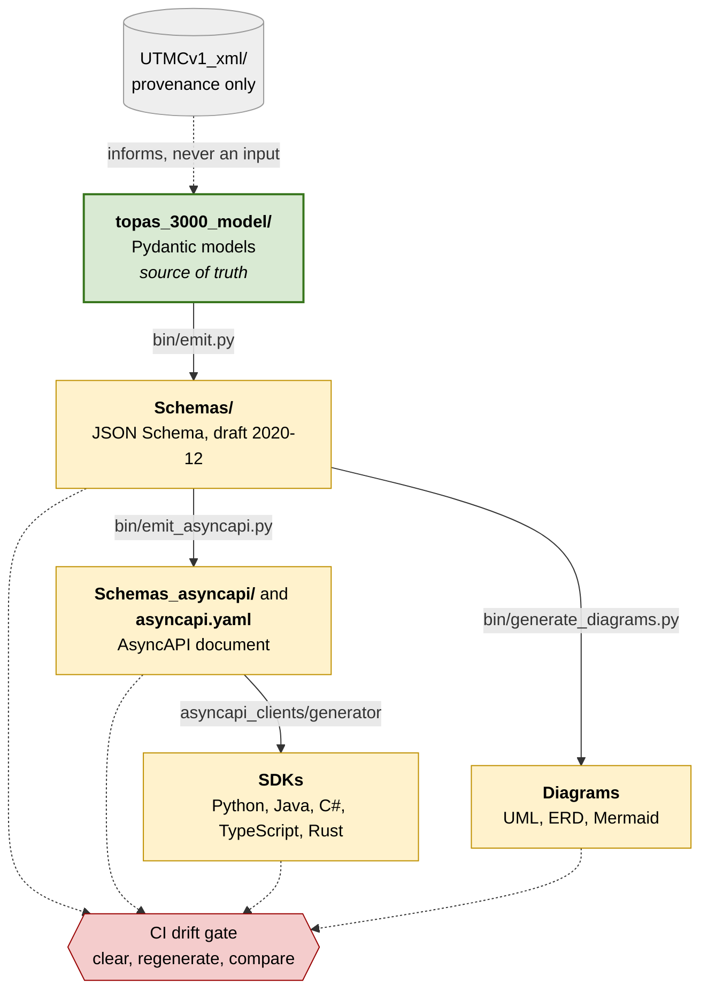
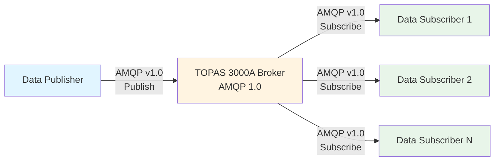
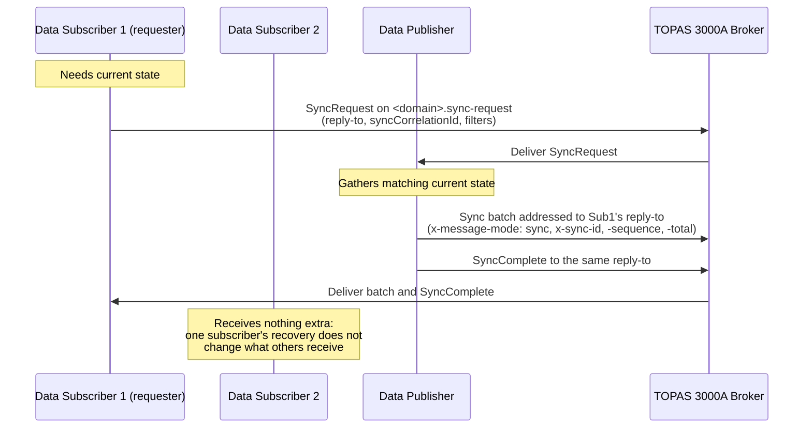
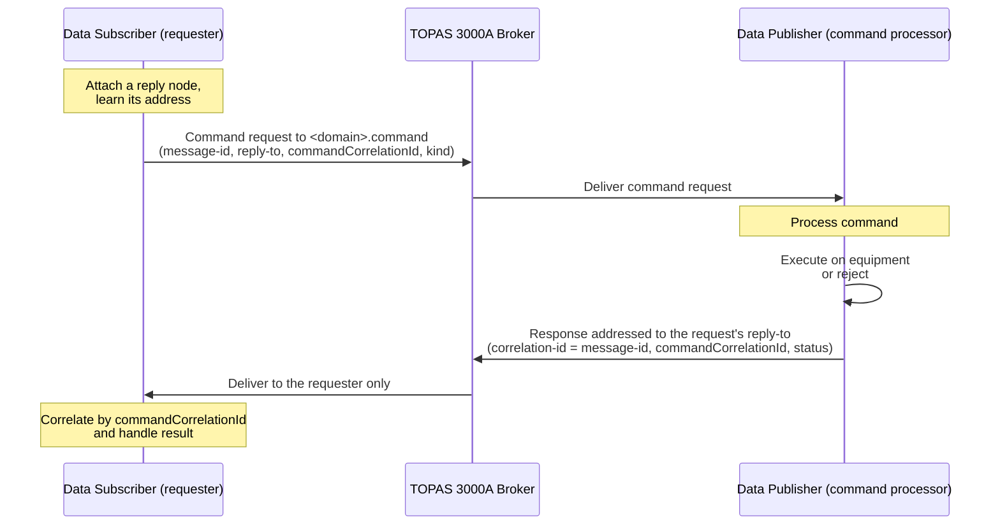
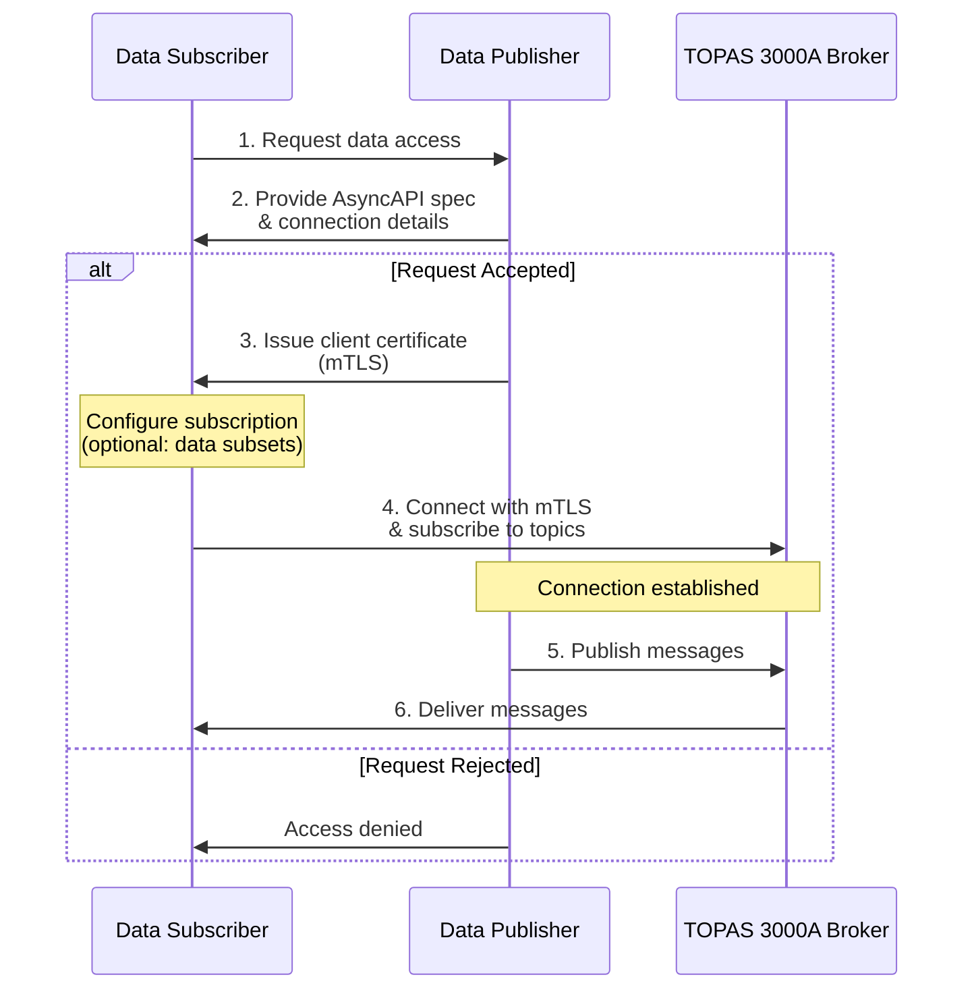

# TOPAS 3000A Specification

## Overview

TOPAS 3000A is the successor to the UTMC standards: a modern replacement for the legacy CORBA-based UTMC interface between applications and services and the Common Database. The standard aims to create an open, interoperable environment for intelligent traffic systems while addressing the limitations of the original UTMC standards introduced from 1997.

### Heritage and naming

TOPAS 3000A is the direct successor to UTMC (Urban Traffic Management and Control), the family of UK open standards first published from 1997 and maintained by the UTMC group. UTMC established the principles this specification continues: open interfaces between systems from different suppliers, a shared object model for traffic management data, and procurement that is not tied to a single vendor.

That heritage is deliberately retained:

- The data model is derived from the UTMC Object Model (UTMC-TS004.006) and its successors, and the legacy object names are preserved for traceability throughout this document.
- The **UTMC Common Database** remains a named consumer of this interface — one Data Subscriber among others, not the only one.
- The specification continues to be published to the UTMC group and TOPAS for industry review (AC1).

The change of name reflects a change of custodianship and transport, not a break with UTMC's purpose. TOPAS 3000A is the successor to UTMC and the only designation this specification uses.

### Source of truth

The Pydantic models under `topas_3000_model/` are the **normative source of truth** for TOPAS 3000A data structures. JSON Schema, the AsyncAPI document, generated SDKs and diagram sources are **derived artefacts** and **MUST NOT** be edited independently. Any change to a derived artefact **MUST** originate from the corresponding model or from the generation pipeline.



*Derived artefacts are generated from the models and never edited by hand. Solid arrows are generation steps; dotted arrows into the gate show what it checks.*

This is enforced rather than asserted. CI clears the generated trees, regenerates them from the models, and fails if committed output differs — so a hand-edited schema, or a model change committed without regenerating, breaks the build. The trees are cleared first deliberately: `git diff` compares content, so a file the generators no longer produce would otherwise survive unchanged and escape the check.

`UTMCv1_xml/` contains historical reference material used to inform the design of these models. It is **provenance, not an input**: it takes no part in schema generation and does not override the models. A discrepancy between a UTMCv1 XSD and a TOPAS 3000A schema is not by itself a defect in the schema.

### Relationship to UTMCv1

TOPAS 3000A uses the UTMCv1 data model (UTMC-TS004.006) as a base to work from, but it is **not backwards compatible** with the original CORBA-based UTMC protocol (referred to as UTMCv1 in this document).

**Source documents by domain.** UTMC-TS004.006 and its UML annex (UTMC-TS004.0061:2010) are the base for most domains. **Traffic signals are derived from UTMC-TS004.0064bis:2017 (*Objects — Traffic Signals*, Sep 17) instead**, which supersedes the 2010 traffic signal objects by direct reference. The 2010 traffic signal profile was carried alongside the 2017 one during review and has since been removed.

**What compatibility means here.** TOPAS 3000A does not interoperate with UTMCv1 on the wire, and is not intended to. The compatibility aim is narrower and about migration: a data concept that UTMCv1 could express and that is still needed SHOULD remain expressible in TOPAS 3000A, so a deployment can move across without losing information. Where the chosen source document omits something the older model carried and implementers still need, it SHOULD be added back to the TOPAS 3000A model rather than the deployment being told to drop it.

Key differences:
- **Protocol**: TOPAS 3000A uses AMQP 1.0 over TCP/IP; UTMCv1 uses CORBA/IIOP
- **Wire Format**: TOPAS 3000A uses JSON; UTMCv1 uses CORBA CDR encoding
- **Security**: TOPAS 3000A uses mTLS; UTMCv1 relies on network-level security
- **Architecture**: TOPAS 3000A uses publish-subscribe messaging; UTMCv1 uses request-response RPC

**Compliance Statement**: A system that is TOPAS 3000A compliant is not required to be UTMCv1 compliant, and vice versa. The two protocols are not interoperable without a translation gateway.

### Purpose

Replace the outdated CORBA interface with a modern, secure, and scalable solution that:
- Reduces integration costs for local authorities
- Lowers the barrier to entry for new market participants
- Enables real-time data sharing
- Uses widely available IT skills and technologies

### Scope

Initial focus is on the interface between Data Publishers and Data Subscribers — including, but not limited to, the UTMC Common Database — covering the domains that are in scope:
- Traffic Signals
- Detectors
- Transport Links
- Transport Routes
- Network (links, nodes, paths, turns and zones)
- Variable Message Signs (VMS)
- Traffic Events (accidents, incidents, roadworks and planned events)
- Strategy
- Faults (a catalogue shared by the device domains)

Anything not in this list is either deferred or will not be done; see *Deferred and Won't Do*.

In its current stages the object types are those held by UTC systems. The interface itself is not limited to them: additional object types SHOULD be requested as extensions to this specification rather than defined in a parallel standard, so that publishers and subscribers of other data continue to share one interface.

---

## Deferred and Won't Do

Only the domains and features listed under *Scope* are part of this specification today. Everything else is listed here, so that nobody reads an omission as an oversight, and so that no deployment is bound to something that does not yet exist. Nothing in the first table has a channel, a published schema or a generated SDK type today, and nothing in this specification binds a deployment to it.

### Deferred

Deferred items are intended for a later phase. They are not part of the current scope, and a later phase may change them before they are adopted.

| Item | What it is | Notes |
|------|------------|-------|
| Access Control | Barrier and gate control | Modelled and tested; not emitted |
| Air Quality | Pollutant concentration readings | Modelled and tested; not emitted |
| Air Quality (enhanced) | Extended pollutant set; definition, configuration and measurement | Modelled and tested; not emitted |
| Car Park | Capacity, occupancy, tariffs and opening times | Modelled and tested; not emitted |
| CCTV | Camera control, image and number-plate readings | Modelled and tested; not emitted |
| Meteorological | Weather station observations | Modelled and tested; not emitted |
| Quantised data | Quantised data as in the UTMC reference | Deferred until a stakeholder asks for it |
| Prediction data | Forecast values for the measurement domains | Deferred with quantised data |
| Cross-domain envelope and aggregation schemas | A combined envelope across all domains | Deferred until all domains are in scope |
| Arbitrary SCOOT messages | Sharing SCOOT data with external systems, for example macro modelling | Proposed; needs analysis and industry consensus |
| Bus priority outcomes | Measuring the effectiveness of bus priority | Proposed; needs analysis and industry consensus |
| Command discovery | A way for a subscriber to learn which commands a system supports | Open; see *Command Messages* |
| Fault catalogue distribution | A channel that publishes fault type catalogue entries | Open; see *Fault Types* |

The first six rows are modelled in `topas_3000_model/` and their tests run, but they are excluded from the live emit (`scope.toml`) until a later phase brings them into scope.

### Won't Do

These are decided against, or are outside what this specification covers.

| Item | Why |
|------|-----|
| Bus monitoring outcome (extension, recall, absolute) | Marked not required during requirements gathering |
| Generic link attributes (delay, stops, degree of saturation and similar) | Marked not required during requirements gathering |
| Wire-level interoperability with UTMCv1 (CORBA) | Not intended; the only bridge is a translation gateway (see *Relationship to UTMCv1*) |
| Storage of historical data by a Data Publisher | Not part of this interface; history is a Data Subscriber responsibility (see *Historical Data Responsibility*) |
| The 2010 traffic signal profile | Removed; traffic signals follow TS004.0064bis:2017 |
| Go and C++ SDKs | Go was removed; C++ has code snippets only and no SDK. SDKs are provided for Python, Java, C#, TypeScript and Rust |

---

## Roles

This specification defines three system roles and two operator roles. These terms are used consistently throughout the document and in the AsyncAPI specification.

| Role | Definition |
|------|------------|
| **TOPAS 3000A Data Publisher** (Data Publisher) | Any system publishing TOPAS 3000A conformant data. A UTC (Urban Traffic Control) system is the most common example, but a variable message sign system or a traffic event source acts in exactly the same role. |
| **TOPAS 3000A Broker** (the Broker) | The AMQP 1.0 message broker that distributes messages from Data Publishers to Data Subscribers. This is infrastructure, not a traffic management product. |
| **TOPAS 3000A Data Subscriber** (Data Subscriber) | Any system consuming TOPAS 3000A data — a UTMC Common Database, a control room dashboard, an analytics platform, or a third-party application. |
| **Publisher operator** | The person or team operating a Data Publisher. |
| **Subscriber operator** | The person or team operating a Data Subscriber. |

**Why these terms:** earlier drafts used "UTC system" for the publishing role and "UTMC system" for both the broker and the consuming role, alongside "UTMC receiver", "UTMC subscriber", "data provider" and "data subscriber" for the same concepts. Those terms carried two assumptions that do not hold:

- Not every Data Publisher is a UTC system. Traffic event, VMS and strategy data can reach the Broker from sources that are not urban traffic control systems, and later phases add more.
- A Data Subscriber is not a "UTMC system". The UTMC Common Database is one possible subscriber; the role is open to any system that wants the data.

Role names are capitalised when they refer to the defined role. Where this document names a specific product — most often the **UTMC Common Database** — it means that product and not the role in general.

---

## Architectural Qualities

| Quality | Description |
|---------|-------------|
| Interoperability | Open for all suppliers |
| Security | Zero trust approach by design |
| Extensibility | Backwards compatible, evolvable data model |
| Scalability | Must scale to any customer size (at least 10,000 objects per type, 100,000 in aggregate) |
| Testability | Easily testable via modern automation techniques |

---

## Acceptance Criteria

### AC1 - Publication
The interface MUST be published to the UTMC group and/or TOPAS for industry stakeholder review.

### AC2 - Data Model
The interface MUST contain a data model replacing UTMC Object Model (UTMC-TS004.006) for:
- Traffic Signals
- Detectors
- Transport Link
- Fault

### AC3 - Extensibility
Additional data objects MAY be agreed between vendors.

### AC4 - Data Transfer
| Ref | Requirement |
|-----|-------------|
| AC4 | Clearly defined data transfer methodology |
| AC4-1 | Transfer data at different cadences (1 second to event-driven) |
| AC4-2 | Reasonably efficient network bandwidth usage |
| AC4-3 | Data need not be human readable in transport |

### AC5 - Security
| Ref | Requirement |
|-----|-------------|
| AC5 | Authenticated and encrypted system-to-system communication using TCP/IP |
| AC5-1 | Secure data in transport over the internet |
| AC5-2 | VPN MUST NOT be required |
| AC5-4 | Transport encryption MUST use TLS 1.3 (RFC 8446). TLS 1.2 and earlier MUST NOT be offered or accepted. |
| AC5-3 | Where requester identity affects command semantics, a deployment MUST demonstrate a trusted propagation mechanism from the authenticated messaging context to the command processor. Sender-controlled message fields are explicitly insufficient. |

**Transport authorisation and application identity are separate concerns.**
Authenticating a connection answers *"may this client send here?"*. It does
not, by itself, answer *"who issued this command?"* at the point the command
is processed:

```
Producer
   |
   |  SASL / mTLS
   v
Broker
   |
   |  "user-a may SEND here"       <- transport authorisation
   v
queued command
   |
   v
Command Processor
   |
   |  "who issued this command?"   <- application identity
```

The first does not deliver the second. A broker may authenticate a producer
for access control while the consuming application receives a message whose
identity-bearing fields remain producer-controlled — verified behaviour on
the reference broker, not a theoretical concern.

This boundary is not specific to idempotency. Anything that attributes a
command to a requester meets it: audit trails, operational accountability
logging, per-originator rate limiting, and command approval rules all
require an identity the requester could not have chosen.


### AC6 - Scalability
| Ref | Requirement |
|-----|-------------|
| AC6 | A conformant deployment MUST scale to at least 10,000 definitions per object type (e.g. 10,000 traffic signals, 10,000 detectors) |
| AC6-1 | Costs scale linearly at worst; economies of scale preferred |
| AC6-2 | Either system can provide data to multiple consumers without performance impact |
| AC6-3 | A conformant deployment MUST scale to at least 100,000 objects in aggregate across all object types, recognising that some types — most notably detectors — carry a multiplier relative to junction count |
| AC6-4 | Data Publisher real-time control performance MUST NOT be impacted by data export at these scale targets |

### AC7 - Robustness
| Ref | Requirement |
|-----|-------------|
| AC7 | Handle failure gracefully |
| AC7-1 | Catch up with missed data after communication failure (configurable limit) |
| AC7-2 | Ignore unknown data types |
| AC7-3 | Data reliability is more important than speed |

### AC8 - Backwards Compatibility
| Ref | Requirement |
|-----|-------------|
| AC8 | Future changes remain backwards compatible and easily extensible |
| AC8-1 | Support vendor-specific data model extensions |
| AC8-2 | Aim to fully replace UTMC CORBA in the future |

### AC9 - Language Independence
Avoid lock-in to specific programming languages.

### AC10 - Code Generation
Enable code generation using modern, widely accepted technologies.

### AC11 - Open Source
Use appropriate Open-Source Software and tools for standardising the test process.

---

## Requirements Notation

Keywords follow BCP 14 ([RFC 2119](https://www.rfc-editor.org/info/rfc2119), [RFC 8174](https://www.rfc-editor.org/info/rfc8174)):
- **MUST**, **MUST NOT**, **REQUIRED**, **SHALL**, **SHALL NOT** - Absolute requirements
- **SHOULD**, **SHOULD NOT**, **RECOMMENDED** - Strong preference with valid exceptions
- **MAY**, **OPTIONAL** - Truly optional

---

## Data Model

### Data Categories

| Category | Schema suffix | Description | Change Frequency |
|----------|---------------|-------------|------------------|
| Definition | `_definition` | Device/system identification and location | Rarely changes |
| Configuration | `_configuration` | Operational parameters and thresholds | Changes occasionally |
| Measurement | `_measurement` | Real-time readings, state, dynamic data | Changes frequently |
| Command | `_command` | Inbound control payloads | Event-driven |
| Command Response | `_command_response` | Command acknowledgement and result | Event-driven |
| Fault | `_fault` | Fault reports and lifecycle | Event-driven |
| Type | `_type` | Type catalogue / lookup definitions | Rarely changes |
| History | `_history` | Audit / event log entries | Append-only |

### Schema Format

TOPAS 3000A JSON Schemas are defined using JSON Schema draft 2020-12 and are the source artefacts for the AsyncAPI specification.

The schemas are authored via Pydantic v2 intermediate models that emit flat, camelCase, discriminator-aware JSON Schema files. Each domain produces one schema file per data category (e.g. `detector_definition-v1.0.json`, `detector_measurement-v1.0.json`). Shared types such as `Quality`, `Point`, and `AcknowledgementState` live in cross-file-referenced library schemas (`common-v1.0.json`, `fault_support-v1.0.json`).

The UTMCv1 data model (UTMC-TS004.006) was used as a reference during authoring but the schemas are **not** a mechanical conversion of the legacy XSD files. See the `README.md` for the rationale behind this approach.

**Class diagrams.** A class diagram for every domain, and one per message category, is generated from the schemas and kept in `Diagrams/` (Mermaid and PlantUML text, and PNG). They show the object structure at class level, which the use-case tables above do not.

**Schema identity.** Each schema's `$id` is the URL of its own file, `<base>/<domain>/<file>.json`, so the relative `../<domain>/<file>.json` references between schemas resolve when the schemas are served at their `$id` as well as on disk. The schemas are to be hosted on GitHub. Until that location is known the base is the placeholder `https://schemas.example.invalid/topas3000a/v1.0` (a reserved top-level domain that never resolves), held in a single constant, `SCHEMA_ID_BASE` in `bin/emit.py`. Replacing it is one change followed by regeneration. A test loads every schema into a registry keyed by `$id` and resolves every reference, so a mismatch between `$id` and reference paths fails the build.

---

## Use Cases - Message Types

TOPAS 3000A is delivered in stages. Stage 1 covers the most widely deployed equipment domains; Stage 2 adds VMS and the supporting domains. The domains that are not in scope are listed under *Deferred and Won't Do*; they are not part of the emitted schemas, the channel list or the SDKs.

**Reading the tables.** The columns below carry these meanings:

| Column | Meaning |
|--------|---------|
| **Timeliness** | The publisher-side target for how long a message may take to reach the Broker, measured from the moment the underlying observation or event occurred to the moment the message is accepted by the Broker. It is not a periodicity, and it excludes Broker-to-subscriber delivery time, which the publisher does not control. A value such as `<3s` therefore means "published within 3 seconds of the event", not "published every 3 seconds". |
| **Historical** | Whether subscribers commonly need to retain this message type for later analysis. Informative — retention is a subscriber responsibility (see *Historical Data Responsibility*). |
| **Criticality** | How much a subscriber's function degrades without this message type. Informative. |
| **Failure Tolerance** | How long a subscriber can reasonably continue without a fresh message before the gap should be treated as a fault. |

Timeliness is a target on the publisher, not an instruction to subscribers. Whether a subscriber must act on a message's age is the subject of *Message Timeliness and Staleness* below, which is under review.

**Names.** The *Schema* column gives each message name in camelCase (`detectorMeasurement`). On the wire the channel is the dotted kebab form of the same name, `detector.measurement`, and the full list is under *Channels*. Command responses (`*CommandResponse`) and `SyncComplete` are replies: each has a schema and a message but no channel of its own (see *Command Response Routing*).

### Stage 1 Messages

#### Detector

| Schema | Use Case | Timeliness | Historical | Criticality | Failure Tolerance |
|--------|----------|------------|------------|-------------|-------------------|
| `detectorDefinition` | Catalogue with locations | 10s | Yes | High | <1h |
| `detectorConfiguration` | Threshold configuration | 10s | Yes | High | <1h |
| `detectorMeasurement` | Flow, speed, occupancy, queue, headway readings | <3s | Yes | High | <30m |
| `detectorCommand` | Reset, calibrate, set threshold | <5s | No | High | <5s |
| `detectorCommandResponse` | Command acknowledgement | <5s | No | High | <5s |
| `detectorFault` | Fault management | <3s | No | High | <1h |
| `detectorType` | Type catalogue lookup | <3s | No | High | <1h |
| `detectorHistory` | Audit log entries | <3s | Yes | High | <1h |

#### Traffic Signal

| Schema | Use Case | Timeliness | Historical | Criticality | Failure Tolerance |
|--------|----------|------------|------------|-------------|-------------------|
| `trafficSignalDefinition` | Controller identification and location | <5s | Yes | High | <1d |
| `trafficSignalConfiguration` | Sub-area, supplier, controller type | <3s | Yes | High | N/A |
| `trafficSignalMeasurement` | Mode, sub-mode, sub-area, plan line and signal-group timings | <3s | Yes | High | <1m |
| `trafficSignalCommand` | Set plan, force/hold stage, synchronise clock | <1s | No | High | <1m |
| `trafficSignalCommandResponse` | Command acknowledgement | <1s | No | High | <1m |
| `trafficSignalFault` | Fault information | <3s | No | High | <15m |
| `trafficSignalType` | Type catalogue lookup | <3s | No | High | <1d |
| `trafficSignalHistory` | Audit log entries | <3s | Yes | High | <1d |

#### Transport Link

| Schema | Use Case | Timeliness | Historical | Criticality | Failure Tolerance |
|--------|----------|------------|------------|-------------|-------------------|
| `transportLinkDefinition` | Link identification, start and end points | <5s | Yes | High | <1d |
| `transportLinkConfiguration` | SCOOT operational parameters | <3s | Yes | High | N/A |
| `transportLinkMeasurement` | SCOOT dynamic, ANPR journey time | <5s | Yes | High | <30m |
| `transportLinkCommand` | Set STOC, recalibrate, request status | <5s | No | High | <5s |
| `transportLinkCommandResponse` | Command acknowledgement | <5s | No | High | <5s |
| `transportLinkFault` | Fault information | <3s | No | High | <15m |
| `transportLinkType` | Link type / link status catalogue | <3s | No | High | <1d |
| `transportLinkHistory` | Audit log entries | <3s | Yes | High | <1d |

#### Shared Libraries

| Schema | Purpose |
|--------|---------|
| `common` | Coordinates, Point, Quality, CommandResponseStatus. Note: command response fields (status, responseTime, code, message) are inlined into each per-domain `*_command_response` schema rather than shared as a composite type. |
| `fault_support` | AcknowledgementState, FaultCategory, FaultStatus, FaultTypeDefinition. A library schema only: no channel is defined for it (see *Fault Types*). |

### Stage 2 Messages

Stage 2 adds the remaining device types and the supporting domains. Each follows the same per-category pattern as Stage 1; the messages a domain actually carries are listed under *Channels*, since not every domain has every category (a network object has no command, a strategy has a status).

| Domain | Notes |
|--------|-------|
| Network | Network topology: links, nodes, paths, turns and zones. No commands or faults |
| Strategy | Strategy definition, status and enable/disable trigger |
| Traffic Events | Accidents, incidents, roadworks and planned events |
| Transport Route | Route definition, configuration and measurement |
| VMS | Variable message sign content and display commands |

---

## Transport Protocol

### Protocol Selection: AMQP 1.0

AMQP v1.0 has been selected as the messaging protocol for TOPAS 3000A. This decision was made based on:
- Built-in error handling mechanisms
- Message queuing and exchange management
- Reduced implementation complexity
- Protocol-level efficiency for high-frequency data exchange

### Message Serialization

**JSON Format:**
- All messages MUST be serialized using JSON (JavaScript Object Notation)
- Message schemas are defined using JSON Schema format
- AsyncAPI specification defines the complete message structure and validation rules

**Rationale:**
- Human-readable for debugging and development
- Wide language support and tooling availability
- Native support in AsyncAPI specification
- Balance between efficiency and interoperability

### Architecture

The system follows a simple publish-subscribe pattern where Data Publishers publish messages to a broker, and Data Subscribers subscribe to receive them.



### Messaging Model

The TOPAS 3000A messaging architecture follows these principles:

**Simple Publish-Subscribe Pattern**
- Data Publishers publish messages to the broker
- Data Subscribers subscribe to receive messages
- The broker handles message distribution to multiple subscribers
- No special broker-side filtering is required as part of the standard

**Message Flow**
- Data Publisher → Broker → Data Subscriber(s)
- One Data Publisher can publish to multiple Data Subscribers via the broker
- Each Data Subscriber subscribes independently

**Message Scope**
- Some messages carry the complete state of an object (e.g., configuration, definitions)
- Others carry only what changed (e.g., detector state changes)
- Either way, a Data Subscriber cannot reach a complete view by waiting. It has heard nothing about an object that has not published since the subscriber connected, whatever the scope of the messages that object sends. Reaching complete current state is therefore a synchronization problem, not a consequence of any message being a delta — see *State Synchronization*

### State Synchronization

A Data Subscriber needs current state when it first connects, when it has been disconnected for longer than Broker retention, or when it wants a filtered snapshot such as every active fault. None of these depend on whether the messages involved are deltas.

The specified method is a request on the domain's `sync-request` channel:

1. A Data Subscriber requires an up-to-date view of the current state of a set of objects
2. It publishes a `SyncRequest` on `<domain>.sync-request`, supplying an AMQP `reply-to` and filters if it wants a subset
3. The Data Publisher publishes the matching current state to the Broker as a sync batch
4. The Broker delivers the batch to that reply node, so it reaches the requester alone

A Data Publisher MAY additionally support an out-of-band trigger for the same effect — see *Vendor-Specific Synchronization Trigger* below — but a conformant deployment MUST support the `sync-request` channel, so that a subscriber can reach current state without depending on a mechanism this specification does not define.

**Requesting a sync.** A Data Subscriber that needs current state without waiting — joining for the first time, recovering from an outage longer than Broker retention, or wanting a filtered snapshot such as every active fault — publishes a `SyncRequest` on the domain's `<domain>.sync-request` channel.

| Field | Meaning |
|-------|---------|
| `syncCorrelationId` | Caller-assigned; the Data Publisher echoes it in the batch's `x-sync-request-id` header |
| `requestTime` | When the request was issued |
| `categories` | Restrict to `definition`, `configuration`, `measurement`, `fault`, `type` or `status`. Omitted means every category |
| `objectIds` | Restrict to named objects. Omitted means all |
| `subArea` | Restrict to one sub-area |
| `typeId` | Restrict to one object type |
| `activeOnly` | Restrict to objects in an active state — for faults, those not yet cleared |
| `since` | Restrict to objects changed at or after this time |

Filters combine with AND, and a request carrying none of them asks for the domain's complete current state — the common case on first connection.

**The response is addressed to the requester, not broadcast.** A `SyncRequest` carries an AMQP `reply-to` exactly as a command does, and the Data Publisher sends the batch there. The same rules apply: `correlation-id` mirrors the request's `message-id`, the reply node is dynamic or provisioned, and the reply address MUST be one the authenticated requester may receive from.

The payloads are unchanged — a synced traffic signal is the same `trafficSignalMeasurement` a delta carries, tagged `x-message-mode: sync` with the `x-sync-id` / `x-sync-sequence` / `x-sync-total` triple and `x-sync-request-id`. **The distinction is routing, not payload.** A normal update goes to the domain's channel; a requested sync of the identical object goes to the requester's reply node.

This matters because a sync can be large. Fanning 10,000 objects out to every subscriber because one asked would make **one subscriber's recovery change the traffic every other subscriber receives** — and AC6-4 requires that data export not degrade real-time control.

**Ending the batch.** The publisher closes every sync with a `SyncComplete` message to the same reply node:

```json
{ "syncCorrelationId": 1234, "syncId": "3f2a...", "status": "success",
  "objectCount": 10037, "completedTime": "2026-08-28T12:04:11+01:00" }
```

The `x-sync-sequence`/`x-sync-total` pair tells a subscriber when a batch is complete, but only once there is at least one message to carry it. A filtered sync matching nothing — "every active fault", when there are none — would otherwise be indistinguishable from a request that was never answered, leaving *"I have heard nothing for five seconds"* as the end-of-batch protocol. `SyncComplete` is sent after the last object, or instead of any objects when none matched, and also reports `rejected` (declined, typically rate-limited) and `failed` (started but not finished, so discard what arrived).

**Publisher-initiated republication is a different operation.** Two things are easily confused, and this specification keeps them separate:

| Operation | Meaning | Routing |
|-----------|---------|---------|
| **Sync request** | "give *me* current state" | Addressed to the requester's reply node |
| **State republication** | "rebuild *everyone's* state now" | The domain's normal channels, as usual |

A Data Publisher MAY republish state nobody asked for — on restart, or after a disconnection longer than its own delta buffer — so that every subscriber holding stale state is corrected. That is a broadcast and belongs on the normal channels. Such a batch carries `x-message-mode: sync` **without** `x-sync-request-id`; that absence is how a subscriber distinguishes a republication of state it may already hold from a new event, and from a batch some other subscriber requested.

**Load.** Answering a sync costs the Data Publisher work, and AC6-4 requires that data export not degrade real-time control. Data Publishers SHOULD therefore rate-limit sync requests and MAY enforce a minimum interval per subscriber, rejecting or deferring requests that arrive faster. Subscribers SHOULD treat a sync as an exceptional operation — on connection, after a detected gap, or on operator action — and not as a substitute for consuming deltas.

**Vendor-Specific Synchronization Trigger:**

Besides the `sync-request` channel, a full state publish MAY also be triggered out of band. This is retained because it reflects how deployments already operate and needs no subscriber-side implementation, but it is an addition to the specified channel rather than a substitute for it. A publish triggered this way is a republication to the domain's normal channels, so every subscriber receives it (see *Publisher-initiated republication*). Examples include:
- Telephone call from subscriber operator to publisher operator who manually triggers the send
- Management API call from Data Subscriber to Data Publisher
- Web interface action by publisher operator
- Scheduled automatic full publish at configured intervals




### Command Messages

Command messages (e.g., `trafficSignalCommand`, `detectorCommand`, `vmsCommand`) follow a bidirectional request-response pattern that differs from the standard data publishing flow.

**Command Flow Overview:**

Unlike data messages which flow one-way from Data Publisher to Data Subscriber, command messages can flow in either direction depending on the use case:

1. **Subscriber → Publisher commands**: Data Subscriber sends a command request to the Data Publisher's `<domain>.command` channel (e.g., change traffic signal plan), supplying an AMQP `reply-to` address
2. **Publisher → requester responses**: Data Publisher sends each response to that `reply-to` address, so it reaches the requester alone. A response is not published to a channel (see *Command Response Routing*)

**Enabling Command Messaging:**

Command messaging from Data Subscriber to Data Publisher is OPTIONAL and requires explicit permission from the publisher operator. When enabled:

- Data Subscribers MAY publish command request messages to the broker, each carrying an AMQP `reply-to` address
- Data Publishers MUST consume the `<domain>.command` channel to receive commands
- Data Publishers MUST send command response messages, after processing, to the request's `reply-to` address
- A Data Subscriber that sends commands MUST attach a reply node and obtain its address before sending the first command

**Message Structure:**

Command request and response schemas follow a consistent pattern across all domains. Each domain's command schema is a discriminated union (tagged by `kind`) with domain-specific variants.

**The `kind` discriminator.** `kind` names which variant of the union a message is; it is not free-text command content and carries no parameters of its own. A command's parameters are the typed fields of the variant `kind` selects — `{"kind": "setPlan", ...}` means the message is a `SetPlanCommand` and therefore carries `planNumber`. This replaces the UTMCv1 pattern of a generic command element holding a command string plus an untyped parameter blob, so a receiver validates the whole payload rather than parsing it.

**Unknown fields are rejected.** Every union variant sets `additionalProperties: false`, so a command carrying a field the variant does not define fails validation. The union wrapper itself declares no properties — it is a `oneOf` over the variants plus a discriminator — so `additionalProperties` is not set there, and setting it would reject every message. Strictness lives on the variants, which is where the properties are.

| Field | Direction | Description |
|-------|-----------|-------------|
| `{domain}Id` | Request | Identifier of the target equipment (e.g. `detectorId`, `trafficSignalId`) |
| `commandCorrelationId` | Request | Unique integer correlating this request with its response. Not an identifier of the command itself. |
| `requestTime` | Request | ISO 8601 timestamp when command was issued |
| `kind` | Request | Discriminator selecting the command variant (e.g. `"reset"`, `"setPlan"`) — see below |
| *(variant fields)* | Request | Command-specific parameters (e.g. `thresholdUp`, `planNumber`) |
| `{domain}Id` | Response | Identifier of the target equipment |
| `commandCorrelationId` | Response | Copied verbatim from the originating request |
| `status` | Response | Outcome enum: `success`, `failed`, `timedOut`, `invalid`, `notSupported`, `pending` |
| `responseTime` | Response | ISO 8601 timestamp when this response was generated |
| `code` | Response | Optional machine-readable result code |
| `message` | Response | Optional human-readable explanation |

**Request-Response Correlation:**

The `commandCorrelationId` field MUST be used to correlate responses with their original requests. It identifies the request/response pair, not the command being issued, and is deliberately not named `correlationId` so it does not collide with the AMQP 1.0 message property of that name. Data Subscribers SHOULD:
- Generate a unique `commandCorrelationId` for each command request
- Track pending commands awaiting a terminal response
- Match incoming responses by `commandCorrelationId`
- Implement timeout handling for commands that do not receive a terminal response

**Command Flow Diagram:**



**Command Response Status Values:**

The `status` field uses the `CommandResponseStatus` enum defined in `common-v1.0.json`:

| Value | Description |
|-------|-------------|
| `success` | Command was successfully executed |
| `failed` | Command execution failed |
| `timedOut` | Command execution timed out |
| `invalid` | Command was rejected as invalid |
| `notSupported` | The command is understood but this Data Publisher does not implement it |
| `pending` | Command accepted but not yet completed |

**Response Streams:**

A command produces a *stream* of responses, not a single response. The schemas have always permitted this — `pending` exists as an interim value alongside four terminal ones, and AMQP 1.0 places no limit on how many messages share a correlation — so the rules are stated here explicitly:

- A Data Publisher MAY send zero or more `pending` responses for one command, each carrying the same `commandCorrelationId`, to report progress on a long-running operation.
- A Data Publisher MUST send exactly one **terminal** response per command — `success`, `failed`, `timedOut`, `invalid` or `notSupported` — with the same `commandCorrelationId`.
- Consumers SHOULD treat *any status other than `pending`* as terminal rather than enumerating the terminal values, so that a future profile adding one does not strand them.
- `pending` responses are **additive**: each is a distinct observation of progress, and a later one does not invalidate an earlier one. Only the terminal response states the outcome.
- A Data Subscriber MUST treat a terminal response as the end of the stream for that `commandCorrelationId` and stop expecting further responses.
- A Data Subscriber SHOULD apply a deadline and surface a `timedOut`-equivalent error if no terminal response arrives.

A publisher with nothing to report between acceptance and completion simply sends the terminal response alone, which is the common case.

**Optional Commands and Conformance:**

Not every command in a domain's union is mandatory. Whether a UTC system exposes force-stage or hold-stage externally varies by supplier and by deployment policy, and a specification that required them would either exclude conformant systems or invite them to claim support they do not have.

- A Data Publisher MAY decline to implement any individual command variant and remains **conformant**.
- A Data Publisher that receives a command it does not implement MUST respond with `notSupported`. It MUST NOT stay silent, fail the request as `invalid`, or report `failed` — those mean the request was malformed and the publisher tried, respectively, and a subscriber cannot tell "this system will never do this" from "this attempt did not work".
- A Data Subscriber MUST treat `notSupported` as terminal for that `commandCorrelationId` and MUST NOT retry the same command against the same publisher. It is a statement about capability, not a transient condition.
- A Data Publisher SHOULD document which command variants it implements, so integrators need not discover capability by probing.

**Commands that change signal state SHOULD be disabled by default.** Force-stage, hold-stage and equivalents in other domains affect live traffic. A deployment SHOULD enable them only where the operator has asked for them and the authorisation model supports it, and a Data Publisher with them disabled answers `notSupported` exactly as one that never implemented them.

**Requesting status.** Several domains' command unions include `{"kind": "requestStatus"}` (traffic signal, transport link and transport route). It asks the equipment's *publisher for the equipment's own current state*. It carries no parameters beyond the common request fields.

- The command response acknowledges the request in the usual way: `success` once the publisher has accepted it and will publish the state, `notSupported` if the publisher does not implement it.
- The state itself is not in the response. The publisher answers by publishing the equipment's current measurement as an **ordinary update**: on the domain's normal `<domain>.measurement` channel with `x-message-mode: delta`, exactly as it would on a change. It is deliberately not a sync. A `sync` message states the complete current state of every object of the type, and a `sync` without `x-sync-request-id` is a publisher-initiated republication that tells every subscriber to rebuild (see *State Synchronization*); a single object sent that way would be mistaken for one or the other. Being an ordinary update, it reaches every subscriber of the channel, as any update does; a subscriber that wants the state for itself alone SHOULD use a `sync-request`.
- `requestStatus` reports the state of the equipment. It does not report the outcome of an earlier command: that is the command response, and re-sending the same `commandCorrelationId` returns the stored result (A11.2). No separate command-status query is defined.
- A subscriber that wants the current state of many objects, or a filtered set, SHOULD use a `sync-request` instead, which is addressed to the requester alone.
- **Status of this definition.** Implemented in the reference responder (`status_responder.py`) and exercised by a conformance scenario (`a13_request_status.py`), which checks the acknowledgement, the delta update and the `notSupported` path, and fails nine injected defects. The reference implementation covers traffic signals only; transport link and transport route carry the same command and follow the same behaviour, but have no reference responder yet. The command's own payload documentation still says only "request the current status".

> **Open:** this specification does not yet define how a subscriber discovers supported commands ahead of sending one. Probing and receiving `notSupported` works but is awkward for an operator interface that wants to present only the commands a system will accept. A capability declaration is a candidate for a future revision.

**Security Considerations:**

- Command messaging MUST use the same mTLS authentication as data messaging
- Data Publishers SHOULD implement authorization checks before executing commands
- Data Publishers MAY restrict which Data Subscribers can send commands
- All command requests and responses SHOULD be logged for audit purposes

**Command Response Routing:**

Command responses are **not** published to a shared topic. A command carries the address its response is to be sent to, and the response goes only there. This is AMQP 1.0's own request/reply addressing; nothing in this specification needs to invent a routing mechanism for it.

| Layer | Field | Purpose |
|-------|-------|---------|
| AMQP message property | `reply-to` | The node the response is sent to. Supplied by the requester on the command. |
| AMQP message property | `message-id` / `correlation-id` | Transport-level correlation. The response sets `correlation-id` to the request's `message-id`. |
| Payload | `commandCorrelationId` | Application-level correlation, carried unchanged from request to response. |

The two correlation layers are deliberate and serve different readers: generic AMQP infrastructure can pair a response to its request without parsing JSON, while the application matches on the identifier its own schema defines.

**Normative rules.**

- A command requester MUST supply an AMQP `reply-to` address on every command.
- A command processor MUST send every response for that command — interim `pending` responses as well as the terminal one — to that address.
- Command responses MUST NOT be distributed by publish/subscribe fan-out. A response is delivered to the requesting system, not delivered to every subscriber and then filtered.
- The response SHOULD set the AMQP `correlation-id` property to the `message-id` of the command it answers.
- The payload `commandCorrelationId` MUST be copied unchanged from request to response.

**Request**

```text
to:               traffic-signal.command
message-id:       8a5c8cd0-...
reply-to:         <the requester's reply node>
```
```json
{ "trafficSignalId": "J01/123", "commandCorrelationId": 1234,
  "requestTime": "2026-08-28T12:15:00Z", "kind": "setPlan", "planNumber": 4 }
```

**Response**

```text
to:               <the request's reply-to>
correlation-id:   8a5c8cd0-...
```
```json
{ "trafficSignalId": "J01/123", "commandCorrelationId": 1234,
  "status": "success", "responseTime": "2026-08-28T12:15:00.350Z" }
```

**Reply nodes.** A reply node is not an administratively provisioned response channel per participant. In the dynamic case nothing is configured at all: the requester attaches a receiver with `dynamic=true`, the broker returns a generated address, and the requester puts that address in `reply-to`. The node exists for the life of the session.

It is worth being explicit that these three properties cannot all hold at once:

1. responses are private to the requester,
2. responses survive the requester disconnecting,
3. the broker holds no requester-specific routing state at all.

Dynamic nodes give (1) and (3). Durable delivery of a response to a requester that has reconnected needs (2), and that requires some requester-specific destination to exist. This is a genuine trade-off rather than an implementation detail, and the choice follows from how long a command may take:

| Pattern | Suits |
|---------|-------|
| **Dynamic reply node** — the requester opens a receiving link with `dynamic=true` and the broker returns a generated address | Connected requesters and commands that complete quickly |
| **Provisioned reply node** — a durable node assigned to the requester, e.g. `responses/subscriber-a` | Long-running commands, and requesters that must survive a reconnection |

A dynamic node's default expiry is tied to the session, so a requester that disconnects between `pending` and the terminal response may leave nowhere to deliver it. Deployments whose commands can outlive a connection SHOULD use provisioned reply nodes. These are private nodes protected by broker access control, not topics protected by a filter: no other subscriber consumes from them.

**A reply-to address has no destination type.** `reply-to` carries an address. Some client APIs — JMS in particular — require a destination *type* that the wire does not supply, and will infer one. A responder in such a client MUST bind the supplied address as a point-to-point destination rather than relying on that inference: a dynamic reply node is private to one requester by definition. Where the inference is wrong the response is delivered nowhere and the requester simply times out, so this failure gives no diagnostic of its own.

**Reply-node readiness is client-library specific.** An application MUST NOT infer that a dynamic reply node is usable from the fact that a receiver object has been constructed. The broker assigns the address, and the point at which a client library makes it available differs:

| Client library | Broker-assigned address becomes available |
|---|---|
| Qpid Proton (Python) | on the link-opened callback |
| Qpid JMS (Java) | immediately — `createTemporaryQueue()` is synchronous |
| AMQPNetLite (C#) | on the attach callback |
| rhea (TypeScript) | on the `receiver_open` event |
| fe2o3-amqp (Rust) | as soon as the awaited `attach()` returns |

A command sent before the address exists has nowhere to be answered, and the failure is a silent timeout rather than an error. Requesters MUST therefore obtain the assigned address before publishing the command.

Note also that these libraries name the concept differently — JMS calls it a `TemporaryQueue`, AMQPNetLite a `Source` with `Dynamic = true`. This specification's term is *dynamic reply node*; no particular client API is implied.

**Payload encoding.** A command or response payload is JSON, and SHOULD be carried as an AMQP **data section** with `content-type: application/json`. An AMQP value section containing a string is also interoperable and is what some clients produce by default. A value section containing *binary* SHOULD NOT be used: it contradicts the accompanying content-type and at least one conformant AMQP client cannot decode it. Implementations MUST be prepared to receive either a data section or a value section containing a string, since client libraries differ in which they emit by default.

**Message and correlation identifiers are typed.** AMQP 1.0 defines `message-id` and `correlation-id` as a union of `ulong`, `uuid`, `binary` and `string`. The requirement that a response's `correlation-id` equal the request's `message-id` is therefore a statement about type as well as value: a `uuid` echoed back as the `string` of its canonical rendering is **not** equal, and a conformant requester MUST NOT treat it as such. Implementations SHOULD compare the identifiers themselves rather than a textual rendering of them — client libraries differ sharply here, and in at least one a `uuid` renders as the empty string, so a rendered comparison silently reports it as absent. A responder SHOULD echo the identifier unchanged in both value and type.

**Observability is not the same as conformance.** A11 constrains what appears on the wire. Whether a client library lets an application *read* a given property is a separate matter: the JMS mapping, for instance, synthesises a destination from the consumer when the AMQP `to` is absent, so a JMS requester cannot distinguish a response that carried `to` from one that did not. This does not relax the requirement on the responder, and it is a property of that client rather than of this specification — other clients observe the same responses correctly. Conformance test suites SHOULD report such a case as a declared gap rather than as a passing assertion: an assertion that cannot fail is not evidence that the requirement was met.

**Sending to an address learned at runtime.** A command processor answers addresses it did not know when it established its links. Two mechanisms are conformant:

- It **MAY** use an AMQP anonymous sender — one with no fixed target, where each message's `to` property routes it — so a single link serves every requester. This is the preferred approach where available; brokers advertise it as `ANONYMOUS-RELAY` at connection establishment.
- It **MAY** instead establish, and cache, an addressed sender per reply node.

Anonymous terminus is a negotiated capability rather than a guaranteed one, so this specification does not require it. What is required is only that the response reaches the request's `reply-to`; how the processor gets it there is an implementation matter.

**Duplicate commands.** AMQP may redeliver a message depending on settlement and recovery, and a requester that times out may retry. Re-executing `setPlan`, `reset` or `forceStage` is materially different from re-delivering a measurement, so command processing MUST be idempotent.

The idempotency key is the **authenticated AMQP principal** together with `commandCorrelationId` — not `x-originator`, which is self-asserted and so cannot bound anything. Given that key:

| Same principal and `commandCorrelationId`, and… | The processor MUST |
|---|---|
| the command is equivalent to the one already completed | return the stored result rather than execute again |
| the command differs — same id, `planNumber` 4 then 7 | reject it as a conflicting correlation identifier, and MUST NOT return the stored result |

**A retry is a new transport exchange.** The same application command may be re-sent with a different `message-id` and a different `reply-to` — the requester may have reconnected and opened a new dynamic reply node. The processor MUST answer each attempt using *that attempt's* transport identity:

| | |
|---|---|
| `to` | the attempt's own `reply-to` |
| `correlation-id` | the attempt's own `message-id` |
| payload | the stored result |

The **result** is replayed; the transport envelope MUST NOT be. Re-sending a stored envelope addresses a reply node that has probably gone away.

Where an equivalent command arrives while the first is still executing, the processor MUST NOT execute it again, and SHOULD register the new attempt so that the terminal response reaches its reply node too.

**Equivalence is judged on the application command**, canonically serialised after schema validation — not on the raw bytes, since `{"kind":"setPlan","planNumber":4}` and the same fields in another order are the same command. Transport properties (`message-id`, `reply-to`, `to`, `correlation-id`) are excluded. Application fields, `requestTime` included, are part of the identity: a re-send that changes one is not an exact retry and falls under the conflict rule above.

**Where the authenticated principal comes from.** Where command idempotency or authorisation depends on requester identity, that identity **MUST** originate from a trusted authentication context, and **MUST NOT** be derived solely from application-controlled AMQP message fields — including `user-id`, `x-originator`, or payload content.

A deployment **MUST** provide a mechanism by which the command processor obtains the authenticated principal. The mechanism is deployment-specific and **MAY** be supplied by the messaging implementation, by a trusted broker extension, or by a trusted ingress component:

| Pattern | Trust model |
|---|---|
| The broker exposes the validated principal to the consumer | Best case — consume that identity directly |
| A broker plugin or interceptor stamps a trusted identity property | The broker **MUST** overwrite or remove any client-supplied value of that property |
| A trusted ingress authenticates the sender and forwards the principal | The ingress becomes the security boundary |

In the second pattern, *overwrite* is the requirement, not *populate if absent*. A property that is only filled in when the client left it empty is `x-originator` with a more convincing name: a client that sets it first keeps control of it.

**If the messaging stack cannot make an authenticated principal available to the command processor, principal-dependent idempotency MUST NOT be claimed as implemented.**

**Qualifying a broker or deployment.** Before relying on a messaging stack to
supply requester identity, a deployment MUST demonstrate an identity that:

1. originates from the authenticated messaging context;
2. cannot be selected or forged by the message producer;
3. survives the asynchronous, queued delivery model;
4. is available at the point the command is actually processed.

All four must hold. The third and fourth are the ones most easily overlooked:
an identity available only while the producer's connection is open does not
survive a command that outlives it, which is why correlating a queued command
back to a live producer session is not a conformant substitute.

This is a property of the broker *and protocol path*, not of the broker
alone — the same broker may satisfy all four on one protocol and none on
another.

Implementers **MUST NOT** assume a broker provides one. Two properties are to be verified against the actual deployment rather than assumed:

- whether an authenticated identity is delivered to the *consumer* at all, and in which message section;
- whether the AMQP `user-id` field is validated. AMQP 1.0 defines `user-id` as set by the sending application; an intermediary *may* authenticate it, and is not required to. A broker that does not overwrite it offers no assurance whatever.

Verified on the reference broker (Apache Artemis 2.31.2), neither holds for an AMQP-to-AMQP path: with `populate-validated-user` enabled no validated user reaches an AMQP consumer, and a `user-id` set by a client authenticated as one principal is delivered unmodified while naming another. The broker does hold the authenticated identity — it reports `validatedUser` for the session through its management interface — so the deficiency is in **propagation to the consumer**, not in authentication.

The general conclusion, which applies well beyond this broker: **authenticating an AMQP connection does not by itself give a downstream consumer trustworthy knowledge of the producer's identity.** The broker may authenticate the producer for access control while the consuming application receives a message whose identity-bearing fields remain producer-controlled.

Correlating a queued command back to a live producer session through broker management is **NOT** a conformant substitute. A command may outlive the connection that sent it, and session identifiers are operational metadata rather than a durable property of the message.

**Idempotency retention.** A deployment MUST configure and disclose an *idempotency retention period* — how long a completed command's result remains replayable. It MUST be at least as long as the longest retry or recovery window the deployment supports; otherwise whether a retry is deduplicated or re-executed depends only on how long the caller took, which is not a property a client can reason about. This specification does not mandate a duration, because it depends on the deployment's recovery model.

Where command execution must remain idempotent across a processor restart, the store MUST be durable. An in-memory store is appropriate only where re-execution after a restart is acceptable.

The second row is what makes this retry-safety rather than mere duplicate suppression: silently returning the plan-4 result to a plan-7 request would report success for something that never happened. A canonical hash of the command payload is a straightforward way to decide equivalence.

How long a processor retains completed commands is a deployment decision, but it SHOULD exceed the subscriber's retry window.

**Security.** Authorisation belongs at the link, not in the payload:

- The `reply-to` address supplied by a requester MUST be **one of exactly two forms**, and a processor MUST reject anything else:
  - **(a)** a broker-created dynamic node established for that authenticated requester, or
  - **(b)** a provisioned node registered to that authenticated principal.

  A syntactically valid broker address is not sufficient. A command processor is typically highly privileged and can write almost anywhere, so accepting an arbitrary supplied address makes it a confused deputy: a requester authenticated as A could set `reply-to` to B's private node and have the processor deliver there on its behalf. Where provisioned nodes are used, binding them to a per-principal namespace makes the check mechanical — `replies/authority-a/...` is acceptable for principal `authority-a` and refused for `authority-b`.
- Authorisation to send commands, and to consume from a reply node, MUST be enforced against the authenticated mTLS principal.
- `x-originator` remains available for audit and tracing, but it is **not** a security primitive: it is self-asserted application data. Where it is used, a command gateway SHOULD derive it from the authenticated principal rather than trusting the value supplied, and MUST reject a value that contradicts it.

> **Note on link pairing.** OASIS also defines *AMQP Request-Response Messaging with Link Pairing*, which pairs a request and response link so `reply-to: "$me"` returns the response down the requester's own link, with no globally addressable reply node at all. It is architecturally cleaner still, but it is a separate specification rather than part of baseline AMQP 1.0 support, so this specification does not require it. A deployment whose broker and clients support it MAY use it.

### Traffic Signal Plan Structure

`trafficSignalMeasurement` carries the running plan as structured rows rather than as parallel arrays. Two nested types do the work:

| Type | Meaning |
|------|---------|
| `PlanLine` | One signal plan as it is currently running: `planNumber`, optional `planStartTime` and `cycleTime`, an `offset`, and the signal-group timings that make it up. |
| `SignalGroupTimings` | One timing row inside a `PlanLine`. Each row names a signal group and gives that group's duration, so a duration is never separated from the group it belongs to. |

A **signal group** is a set of signal heads that change together — typically one approach or one movement through the junction. `primarySignalGroup` names the group the row is about and `primarySignalGroupDuration` gives its length in seconds. `alternateSignalGroup` names groups that run as an alternative to the primary one; per UTMC-TS004.0064bis:2017 there is deliberately no separate duration for the alternate, because it runs within the primary group's timing.

Row order within `planLine` is the order in which the groups run, so the sequence carries no separate index.

This replaces the UTMCv1 pattern of a single stage-sequence value alongside a separate array of stage durations, where nothing tied a duration to the stage it described. Pairing each duration with its group in one row removes that ambiguity.

**Two different "type" concepts.** Traffic signals carry two attributes that both read as a type, and they mean different things:

| Attribute | Where | What it says |
|-----------|-------|--------------|
| `trafficSignalType` | field on `trafficSignalConfiguration` | The regulatory class of the junction or crossing: `intersection`, `pegasus`, `pelican`, `puffin`, `toucan`, `tramCrossing`, `wigWag`, `other`. Enumerated by UTMC-TS004.0064bis:2017. |
| `TrafficSignalType` | the `trafficSignalType` **channel** | The control method in use — MOVA, SCOOT, fixed-time and so on. A catalogue keyed by `controlMethodId`, whose values are deployment-specific rather than fixed by this specification. |

**Type identifiers are strings.** Every `TypeId` — `typeId`, `controlMethodId`, `faultTypeId` and the rest — is a string of 1 to 64 characters, not an integer. UTMCv1 defined `TypeIdType` as `xsd:integer`, but it also defined a parallel `TypeIdEnum` as `xsd:string`, and the values deployments actually use are alphanumeric: `MOVA`, `QMISS`, `MIDAS`, fault codes such as `A1` and `F3`, and vendor identifiers. An integer key cannot carry those without a lookup table nobody shares.

The format is deliberately not constrained beyond length and the absence of leading or trailing whitespace, so that a legacy numeric key (`"1"`), a control-method name (`"MOVA"`), a fault code (`"A1"`) and an approval reference are all valid. Where a vendor or deployment defines its own types, a dot-namespaced form such as `yunex.lampFault` is RECOMMENDED so those values cannot collide with catalogue entries defined by this specification.

They are not duplicates and neither can be derived from the other: a pelican crossing may be fixed-time or MOVA-controlled.

### Fault Types

A fault's kind is a **catalogue reference**, not an enumerated value. Every fault payload carries a `faultTypeId` pointing at a `FaultTypeDefinition` entry, and the catalogue carries what the fault means. The one exception is the traffic signal fault, which may instead carry only its TS004.0064bis:2017 enumeration (below).

| Catalogue field | Purpose |
|-----------------|---------|
| `faultTypeId` | The catalogue key, referenced by fault instances |
| `description` | What the fault is |
| `code` | The identifier the fault carries in its source or vendor documentation — `A1`, `F3`, `W12`. Distinct from `faultTypeId`, since two vendors may publish the same code |
| `category` | Coarse grouping for filtering: `hardware`, `communications`, `signalTimings`, `environmental`, `other` |
| `messageTemplate` | Human-readable message with positional placeholders |
| `parameterNames` | Names for those placeholders, in order |

**Why a catalogue rather than an enumeration.** A closed enumeration can only express faults that were known when the schema was written, and only those whose meaning is fixed. Many real faults are neither. A timing fault means nothing without its values — *"minimum green not met: stage 3 ran 4s against a minimum of 7s"* — and an enumeration has nowhere to put the 3, the 4 and the 7.

The traffic signal enumeration inherited from TS004.0064bis:2017 illustrates the limit: of the 46 fault codes published for signal equipment, it classifies ten and collapses the remaining 36 — every communications fault and every signal-timing fault — into `other`. A stuck stage and a lamp failure were indistinguishable.

**Templated messages.** A fault instance supplies `parameters`, the values for its catalogue entry's placeholders, in order:

```json
{
  "trafficSignalId": "TS-014",
  "faultTypeId": "F3",
  "parameters": ["3", "4", "7"],
  "faultLastUpdateTime": "2026-08-27T09:14:22+01:00"
}
```

A subscriber holding the catalogue renders the sentence. One that does not still has the fault type and its values, which is more than an unrecognised enum member would give it.

**Adding a fault type requires no schema change.** New types — a vendor's own, or ones a future profile defines — are catalogue entries (`FaultTypeDefinition`, in the `fault_support` library schema). Deployments SHOULD namespace their own entries (`yunex.lampFault`) so they cannot collide with entries defined by this specification.

> **Open:** no channel is defined for publishing catalogue entries. `FaultTypeDefinition` exists only as a library schema that each domain's fault message refers to by `faultTypeId`, so how a subscriber obtains the entries is not yet specified. A publisher SHOULD make its catalogue available to its subscribers; the means is a candidate for a future revision.

**Traffic signals retain the DATEX II enumeration.** `trafficSignalFaultType` is still present and still carries its TS004.0064bis:2017 values. A traffic signal fault MUST carry `faultTypeId`, `trafficSignalFaultType` or both, so a fault written to the 2017 profile alone (which requires the enumeration and has no catalogue reference) is accepted. When both are present, `faultTypeId` is the authoritative classification and the enumeration is a coarse bucket for consumers written against that profile. A Data Publisher SHOULD send `faultTypeId` where it can: the enumeration files 36 of the 46 published codes under `other`. The rule is in the JSON Schema as well as the models.

### Fault Severity and Urgency

**Scope.** Only traffic signal faults carry these two gradings today (`faultSeverity` and `trafficSignalFaultUrgency`). Faults in every other domain carry an integer `severity` (higher is more severe) and no urgency; extending the gradings to them is not yet specified. The rest of this section describes the traffic signal gradings.

Traffic signal fault messages carry two independent gradings, both drawn from DATEX II. They answer different questions and SHOULD NOT be set from one another:

| Field | Question it answers |
|-------|---------------------|
| `faultSeverity` | How much is the equipment's function degraded **now**? |
| `trafficSignalFaultUrgency` | How soon must someone attend to it? |

A fault can be severe but not urgent (a signal head failed on an approach that is closed for roadworks) or urgent but not severe (a cabinet door left open — the equipment works, but it is exposed).

**Severity** — `low`, `medium`, `high`, `unknown`:

| Value | Guidance |
|-------|----------|
| `high` | The equipment is not performing its safety or control function. Signals dark or on flashing amber, a controller off-line, a detector reporting nothing on a SCOOT-critical link. |
| `medium` | The function is degraded but still delivered. One lamp of a repeated aspect out, one detector of several on an approach failed, a plan running in fallback. |
| `low` | The function is unaffected. Cabinet door ajar, a cleared fault retained for audit, a diagnostic warning. |
| `unknown` | The publisher cannot determine severity. Use this rather than guessing — a wrong `low` hides a real fault. |

**Urgency** — `extremelyUrgent`, `urgent`, `normalUrgency`, `unknown`:

| Value | Guidance |
|-------|----------|
| `extremelyUrgent` | Attend immediately; there is a live safety or serious-disruption risk. Conflicting greens detected, signals dark at a major junction, a structure or barrier fault that could injure. |
| `urgent` | Attend within the operator's same-day or next-visit target. The fault is degrading service or will escalate if left. |
| `normalUrgency` | Attend on the routine maintenance cycle. |
| `unknown` | The publisher cannot determine urgency. |

`unknown` on both fields is a deliberate divergence from the DATEX II baseline, which omits it on urgency. A publisher that genuinely cannot grade a fault MUST be able to say so; defaulting such a fault to `normalUrgency` would silently understate it.

These are the meanings a subscriber may assume. They are guidance for choosing a value, not a validation rule — no message is rejected for grading a fault differently.

### Requirements

| Requirement | Level |
|-------------|-------|
| Message-driven architecture with broker pattern | MUST |
| AMQP standard version 1.0 | MUST |
| Data Publisher acts as message publisher | MUST |
| Data Subscriber acts as message subscriber | MUST |
| Broker responsibility of the Data Publisher | SHOULD |
| Broker MAY distribute to multiple Data Subscribers | MAY |
| Conformance depends on Broker-side filtering | MUST NOT |
| mTLS authentication | MUST |
| AsyncAPI specification provided | MUST |

### AMQP Broker Requirements

**Broker Agnostic Specification:**

This specification is broker-agnostic and does not mandate a specific AMQP broker implementation. Any AMQP 1.0 compliant broker MAY be used, provided it supports the required features listed below.

**Minimum Required Features:**

The AMQP broker MUST support the following features to be compatible with this specification:

| Feature | Requirement | Level | Description |
|---------|-------------|-------|-------------|
| AMQP 1.0 Protocol | Full compliance with AMQP 1.0 specification | MUST | Core protocol support |
| TLS 1.3 | Support TLS 1.3 for transport encryption, and refuse earlier versions | MUST | Secure transport. TLS 1.3 is the current recommended protocol: a faster handshake and stronger default security (RFC 8446) |
| X.509 Client Certificates | Mutual TLS authentication using client certificates | MUST | mTLS authentication |
| Publish-Subscribe Pattern | Topic-based publish-subscribe messaging | MUST | Core messaging pattern |
| Message Persistence | Durable message storage to disk | SHOULD | Reliability and catch-up capability |
| Queue Durability | Queues survive broker restart | SHOULD | System resilience |
| Message Acknowledgment | AMQP acknowledgment mechanism | MUST | Delivery confirmation |
| At-Least-Once Delivery | Guarantee message delivery at least once | MUST | Reliability requirement |
| Multiple Subscribers | Support multiple concurrent subscribers per topic | MUST | Multi-consumer support |
| Message Retention | Configurable message retention period | SHOULD | Catch-up after disconnection |
| JSON Message Support | Handle JSON payloads without transformation | MUST | Message format compatibility |

**Recommended Features:**

The following features are RECOMMENDED but not required:

| Feature | Level | Benefit |
|---------|-------|---------|
| Message TTL (Time-To-Live) | RECOMMENDED | Automatic stale message cleanup |
| Dead Letter Queues | RECOMMENDED | Handle undeliverable messages |
| Management API | RECOMMENDED | Operational monitoring and management |
| Metrics/Monitoring | RECOMMENDED | Performance and health monitoring |
| High Availability | RECOMMENDED | Broker clustering for resilience |
| Message Filtering | OPTIONAL | Subscriber-side filtering (not required by spec) |
| Message Compression | OPTIONAL | Bandwidth optimization |

**Broker Selection Considerations:**

When selecting an AMQP broker, Data Publishers SHOULD consider:

- **Scalability**: Ability to handle message volumes at the AC6 scale targets (at least 10,000 objects per type, 100,000 in aggregate)
- **Performance**: Message throughput sufficient for timeliness requirements (<1s to <5s)
- **Operational Maturity**: Production-ready with stable releases and support
- **Resource Requirements**: CPU, memory, and storage needs
- **Licensing**: Compatible with organizational requirements
- **Vendor Support**: Availability of commercial support if required

**Common AMQP 1.0 Brokers:**

Examples of AMQP 1.0 compliant brokers that MAY be suitable (non-exhaustive list):

- Apache Qpid Dispatch Router (note: project maintenance has slowed; evaluate current status)
- Apache ActiveMQ Artemis
- RabbitMQ (native AMQP 1.0 from v4.0; earlier versions require AMQP 1.0 plugin)
- Azure Service Bus
- Amazon MQ
- Red Hat AMQ

**Note:** This specification does not endorse any specific broker implementation. The choice of broker is a vendor decision based on operational requirements.

**Broker Configuration:**

Data Publishers MUST provide Data Subscribers with:
- Broker connection details (hostname, port)
- Required TLS configuration
- Topic/queue naming conventions
- AsyncAPI specification documenting available channels
- Client certificate for mTLS authentication

**Interoperability Testing:**

Implementations SHOULD be tested against multiple AMQP broker implementations to ensure true broker-agnostic compatibility.

### Data Access Request Flow

The process for establishing data access between Data Publisher and Data Subscriber systems:

1. The Data Subscriber requests access to data, and the Data Publisher accepts or rejects the request. **This step is out of band.** It is an administrative and commercial exchange between the two organisations — it is not a TOPAS 3000A message, no channel carries it, and this specification does not define its form. Steps 2 onward are in scope and are specified here.
2. On acceptance, the Data Publisher supplies access details as an AsyncAPI specification — Broker hostname and port, TLS configuration, and the available channels
3. On acceptance, the Data Publisher issues the Data Subscriber a client certificate for mTLS
4. The Data Subscriber connects to the Broker with mTLS and subscribes to the channels it wants; it MAY subscribe to a subset rather than all of them
5. The Data Publisher publishes messages to the Broker
6. The Broker delivers messages to the Data Subscriber

If the request is rejected at step 1, no certificate is issued and no connection is possible.



### Data Updates

| Update Type | Description |
|-------------|-------------|
| Full state publish | Every object of a type published in one batch. Sent on first connection, periodically as the Data Publisher is configured, and on request (see *State Synchronization*). |
| Delta Updates | Changes to measurements and faults as they occur |
| Synchronization | A sync batch delivered to a requester's reply node in answer to a `sync-request`, closed by a `SyncComplete`. A full publish triggered out of band is a permitted addition (see *State Synchronization*) |

### Historical Data Responsibility

**Fire-and-Forget Model:**

The TOPAS 3000A specification follows a fire-and-forget messaging model for data distribution:

- Data Publishers MUST NOT be required to store *previous* states of an object for this interface
- Data Publishers publish current state and events as they occur
- Once published to the Broker, the Data Publisher has fulfilled its responsibility for that message
- Historical data storage is NOT part of this specification

This is a limit on retaining history, not on serviceability. A Data Publisher MUST remain able to publish the **current** state of any object it publishes at all, on request, even where the message that first established that state was sent long ago and is no longer in Broker retention. Without that guarantee, a subscriber joining late — or recovering from an outage longer than the retention window — could never reach a complete view, and the synchronization mechanism described above would not work.

**Data Subscriber Responsibility:**

If historical data access is required for a use case:

- Data Subscribers MUST implement their own historical data storage
- Data Subscribers are responsible for capturing, storing, and managing historical records
- Data Subscribers SHOULD store messages with timestamps for temporal analysis
- Historical data retention periods are determined by Data Subscriber requirements, not this specification

**Rationale:**

- Simplifies Data Publisher implementation and reduces resource requirements
- Allows Data Subscribers to implement storage strategies suited to their specific needs
- Prevents duplication of storage across multiple subscribers
- Aligns with publish-subscribe pattern where publishers are stateless
- Enables Data Subscribers to implement different retention policies based on message criticality

**Implementation Notes:**

- Data Publishers MAY implement internal historical storage for their own operational purposes, but this is outside the scope of this specification
- Broker message retention (24 hours to 7 days) provides short-term catch-up capability only, not long-term historical access
- Data Subscribers requiring historical analysis SHOULD implement time-series databases or similar storage solutions

### Time and Time Zone Handling

Every message carries at least one timestamp, and traffic data is analysed in local wall-clock time — so how time is written on the wire, and what a subscriber may infer from it, both need stating.

**Wire format.** Timestamps use the [W3C profile of ISO 8601](https://www.w3.org/TR/NOTE-datetime), which is the subset most implementations mean when they say "ISO 8601":

- Every timestamp MUST be timezone-aware. Naive, offset-less timestamps MUST be rejected. This is already enforced: all timestamp fields resolve to a timezone-aware type and a naive value fails validation at parse time.
- A timestamp MUST carry the **local UTC offset that applied at the moment of generation** — `2026-07-15T10:30:00+01:00`, not the same instant normalised to `2026-07-15T09:30:00Z`. Both denote the same instant, but only the first records which local hour the observation belongs to. Normalising to `Z` at the publisher discards that, and it cannot be recovered downstream.

**Deployment time zone.** Offset alone does not identify a time zone — `+01:00` is BST in London and CEST in Berlin, and the two behave differently across a DST transition.

- A deployment MUST declare its IANA time zone identifier (e.g. `Europe/London`) as `x-deploymentTimezone` on the AsyncAPI server object.
- Subscribers MUST NOT infer a deployment's time zone from a message's UTC offset.
- Subscribers SHOULD use the declared identifier when bucketing or aggregating by wall-clock time.

**Why the offset matters here.** Traffic data is compared against the same local time on other days: flow at 08:15 in January against flow at 08:15 in July. Those are different UTC instants, but the same point in the traffic day, and an operator comparing them wants them in the same bucket. Carrying the generation offset plus the deployment identifier lets a subscriber do that without guessing.

**DST transitions.** The following is **guidance, not conformance**. The affected period is one hour twice a year and matters little to most subscribers; a subscriber whose use case genuinely depends on that hour will want it, and one that does not may ignore it entirely without becoming non-conformant.

- *Spring forward* — one wall-clock hour does not occur. It will contain no observations. A subscriber SHOULD treat that as "no such local time" rather than as missing or late data, so the gap is not raised as a fault.
- *Fall back* — one wall-clock hour occurs twice, giving two distinct instants for each local minute. A subscriber SHOULD retain both observations rather than letting the second overwrite the first. How they are then bucketed is the subscriber's choice: aggregating both into one wall-clock bucket and distinguishing them by offset (`01:30 BST` against `01:30 GMT`) are both reasonable, and this specification does not require either.
- Publishers need no special handling. Emitting the generation offset, as required above, already makes both hours unambiguous on the wire.

**Displays and audit.** Operator-facing displays SHOULD render times in the deployment time zone, showing the offset explicitly during a transition hour where the local time would otherwise be ambiguous. Audit logs SHOULD retain the original wire timestamp verbatim, offset included, so the original instant stays recoverable.

### Message Timeliness and Staleness

Messages include timestamps to enable subscribers to determine data freshness. Subscribers MUST implement staleness checking on their message timeliness.

**Staleness Rules:**

The threshold for a message is the timeliness stated for it in the use-case tables. A message older than its threshold is *stale*. What a subscriber does with a stale message is governed by the *Implementation* rules below: checking is a MUST, discarding or flagging is a SHOULD, and using stale data for a critical operation is a MUST NOT. Whether discarding should itself become mandatory is an open question for the working group.

| Timeliness Requirement | Staleness Threshold | Stale when |
|------------------------|---------------------|------------|
| <1s | 1 second | Older than 1 second |
| <3s | 3 seconds | Older than 3 seconds |
| <5s | 5 seconds | Older than 5 seconds |
| 10s | 10 seconds | Older than 10 seconds |
| <1m | 1 minute | Older than 1 minute |
| <5m | 5 minutes | Older than 5 minutes |
| <15m | 15 minutes | Older than 15 minutes |
| <30m | 30 minutes | Older than 30 minutes |
| <1h | 1 hour | Older than 1 hour |

**Implementation:**
- Each message MUST include a timestamp indicating when the data was generated
- Subscribers MUST compare message timestamp against current time
- If message age exceeds the timeliness requirement, the message SHOULD be discarded or flagged as stale
- Stale data MUST NOT be used for critical operations (e.g., strategy decisions, real-time displays)

**Example:** A `trafficSignalMeasurement` message with timeliness requirement of <3s that arrives 5 seconds after generation is considered stale and should not be used for strategy input.

### Error Handling for Subscribers

A subscriber MUST keep working when something goes wrong, and MUST NOT damage the broker or other subscribers while it does so. The rules below are the whole of the normative requirement; *Implementation guidance* after them is informative.

**Requirements:**
- A subscriber MUST attempt automatic reconnection after a connection failure, and MUST NOT assume the broker is available.
- A subscriber MUST discard a message that is not valid JSON or does not validate against its schema, and MUST continue processing the messages that follow.
- A subscriber MUST ignore a message type it does not know (AC7-2, forward compatibility).
- A subscriber MUST NOT block the broker. If it cannot keep up with the message rate, it handles that locally.

**Implementation guidance (informative):**
- *Reconnection.* Exponential backoff is the usual approach: retry after 1 second, doubling to a maximum of 60 seconds. Log each failure for operational monitoring.
- *Invalid messages.* Log the error with the message id so an operator can trace it. Alert an operator if the data is critical.
- *Missing data.* If expected periodic messages stop arriving, alert an operator after about twice the expected interval, or, for critical data such as `trafficSignalMeasurement`, once the failure tolerance period is exceeded. A subscriber MAY request a full state synchronisation (see *State Synchronization*) when it detects a gap.
- *Duplicates.* The broker delivers at least once (see *AMQP Broker Requirements*), so a subscriber SHOULD deduplicate using message ids, process each unique message once, and log detected duplicates for monitoring.
- *Backpressure.* Use local queuing with overflow handling. When the queue is full, discard the oldest non-critical messages first, and prioritise critical ones (faults, commands).

### Message Retention and Durability

The broker configuration determines message retention and durability characteristics:

**Broker Responsibilities:**

| Aspect | Requirement | Level |
|--------|-------------|-------|
| Message persistence | Messages SHOULD be persisted to disk | SHOULD |
| Retention period | Minimum 24 hours for all message types | SHOULD |
| Queue durability | Queues SHOULD survive broker restart | SHOULD |
| Message acknowledgment | Support AMQP acknowledgment mechanism | MUST |
| Delivery guarantee | At-least-once delivery | MUST |

**Retention Guidelines by Message Type:**

| Message Category | Minimum Retention | Rationale |
|------------------|-------------------|-----------|
| Definition messages | 7 days | Rarely change, needed for new subscribers |
| Configuration messages | 7 days | Infrequent changes, needed for synchronization |
| Dynamic/measurement messages | 24 hours | High frequency, historical access via separate system |
| Fault messages | 7 days | Important for audit trail and analysis |
| Command messages | 24 hours | Audit trail for operational actions |

**Subscriber Catch-Up:**
- When subscriber reconnects after disconnection, it SHOULD receive messages retained during outage
- Retention period limits maximum catch-up window (per AC7-1)
- If disconnection exceeds retention period, subscriber MUST request full state synchronization
- Broker MAY implement per-subscriber queue limits to prevent resource exhaustion

**Publisher Responsibilities:**
- Publisher SHOULD wait for broker acknowledgment before considering message sent
- Publisher MAY implement local buffering for broker unavailability
- Publisher SHOULD alert operator if broker unavailable for extended period (>5 minutes)

**Operational Monitoring:**
- Broker SHOULD expose metrics for queue depth, message rates, and retention usage
- Operators SHOULD monitor these metrics to ensure system health
- Alerts SHOULD be configured for queue depth exceeding thresholds

---

## Security

### Mutual TLS (mTLS)

- Data Publisher provides message broker and manages Certificate Authority
- Client certificates created for Data Subscribers
- Enables secure communication over public networks without VPN
- Adheres to zero trust principles

### Transport protocol version

Connections between a Data Publisher, the Broker and a Data Subscriber MUST use TLS 1.3. A Broker MUST NOT offer, and a participant MUST NOT accept, TLS 1.2 or earlier. TLS 1.3 is the current recommended protocol (RFC 8446): it has a faster handshake, and its default cipher suites and key exchange are stronger than those it replaced. Cipher suites are limited to those TLS 1.3 defines. A deployment cannot rely on an earlier version for an older participant; such a participant has to be upgraded or placed behind a gateway that terminates TLS 1.3 itself.

### Certificate Management

| Responsibility | Party |
|----------------|-------|
| Certificate Authority management | Data Publisher |
| Client certificate creation | Data Publisher |
| Certificate validity checking | Data Subscriber |
| Renewal request before expiry | Data Subscriber |

### Additional Security Measures

**Vendor-Specific Security:**

Vendors MAY implement additional security measures beyond the requirements of this specification, provided that:

- Additional measures MUST NOT make the solution incompatible with this specification
- Additional measures MUST NOT require the other party to install additional software, hardware, or services
- Additional measures MUST NOT prevent compliant implementations from connecting

**Examples of Compatible Additional Security:**
- Enhanced certificate validation (e.g., certificate pinning)
- Additional logging and monitoring
- Rate limiting at the broker level
- IP address allowlisting (if mutually agreed between parties)
- Enhanced encryption cipher suites (within TLS 1.3 standard)

**Examples of Incompatible Additional Security:**
- ❌ VPN requirements - Would require additional software/configuration from subscriber
- ❌ Proprietary authentication mechanisms - Would prevent standard mTLS clients from connecting
- ❌ Custom encryption protocols - Would break AMQP v1.0 compatibility
- ❌ Mandatory third-party security services - Would create external dependencies

**Rationale:**

The specification mandates mTLS (AC5) to ensure secure communication without VPN requirements (AC5-2). Any additional security measures that reintroduce such requirements would violate the core design principles of:
- Low barrier to entry for new market participants
- Avoiding lock-in to specific vendors or technologies
- Using widely available IT skills and technologies

Vendors implementing additional security SHOULD document these measures clearly and ensure they remain optional or transparent to compliant implementations.

---

## AsyncAPI Specification

The interface is defined using [AsyncAPI](https://www.asyncapi.com/en) 2.6.0 specification.

**Version Selection Rationale:**

AsyncAPI 2.6.0 was selected over the newer 3.x versions for the following reasons:

- **Tooling Maturity**: AsyncAPI 2.6.0 has broader tooling support and more mature code generators
- **Stability**: Version 3.0 introduced breaking changes (decoupled channels from operations, revised parameter objects) that are still being adopted by the ecosystem
- **Industry Adoption**: Most production implementations currently use 2.x versions
- **Migration Path**: When AsyncAPI 3.x tooling matures and industry adoption increases, a migration guide will be provided

**Future Migration:**

Migration to AsyncAPI 3.x will be considered when:
- Code generation tools fully support 3.x features
- Industry tooling ecosystem has stabilized
- A clear migration path can be documented without breaking existing implementations

### The AsyncAPI document and the schemas

The AsyncAPI document is generated from the JSON Schemas, so the data model and the messaging interface cannot disagree. How it is generated is a build matter and not part of this specification. What this specification requires of the result is:

- **Channels.** One channel per schema file that is published or requested, named `{domain}.{category}` (see *Channel Naming Convention*). Data channels (definition, configuration, measurement, fault, type, history) are published by the Data Publisher. Command channels and `{domain}.sync-request`, one per data-bearing domain, are written to by a Data Subscriber (see *State Synchronization*).
- **No reply channels.** Command responses and `SyncComplete` have no channel. Each is a reply, sent to the requester's `reply-to` address; the pairing is declared on the request channel by the `x-amqp1-request-reply` extension (see *Request and reply in the AsyncAPI document*).
- **Messages.** Each channel and each reply message references its schema by `$ref` and carries the `topasEnvelope` or `topasRequestReply` trait. **There is no JSON body envelope.** The payload is the object itself, and the routing metadata a body envelope would have carried lives in AMQP application properties (see *Message Properties*), so a broker can filter without deserialising payloads.
- **Security.** The document declares X.509 mutual TLS as its security scheme, and TLS 1.3 as the only permitted protocol version (see *Security*).

**Message Properties:**

A TOPAS 3000A message body is the payload object alone. Routing and sync metadata are carried in AMQP application properties, so a broker can filter and route without deserialising the body. The `topasEnvelope` message trait in `asyncapi.yaml` declares them, apart from `x-originator`, which only request and reply messages carry and the `topasRequestReply` trait declares (see below):

| Property | Type | Meaning |
|----------|------|---------|
| `x-message-mode` | `sync` \| `delta` | Publication scope. `sync` is the complete current state of the objects of this type; `delta` is only what changed. The payload schema is identical for both (A3) |
| `x-content-type` | string | Payload schema reference matching the channel and version, e.g. `detector.measurement-v1.0` |
| `x-geo-tile` | string | Geographic tile code for location-based filtering (A2). The publisher computes it from the object's location at publish time |
| `x-geo-tile-system` | `geohash` \| `s2` \| `intercor` | Encoding of `x-geo-tile`. Required if `x-geo-tile` is set. `geohash` is recommended |
| `x-sync-id` | uuid | Identifies a sync batch (A5). Required when `x-message-mode` is `sync` |
| `x-sync-sequence` | integer ≥ 1 | 1-based position within the batch (A5). Required when `x-message-mode` is `sync` |
| `x-sync-total` | integer ≥ 1 | Total messages in the batch (A5). The batch is complete when sequence equals total. Required when `x-message-mode` is `sync` |
| `x-sync-request-id` | integer ≥ 0 | Echoes the `syncCorrelationId` of the `SyncRequest` that triggered the batch. Absent on a publisher-initiated republication |
| `x-originator` | string | Identity the sender asserts for itself, on request/reply messages only. Audit and tracing only (A11); never an authority |

`x-message-mode` and `x-content-type` MUST be present on every data message (definition, configuration, measurement, fault, type, history and the Stage 2 equivalents). When `x-message-mode` is `sync`, `x-sync-id`, `x-sync-sequence` and `x-sync-total` MUST also be present. `x-geo-tile-system` MUST be present whenever `x-geo-tile` is. Command requests, command responses, sync requests and `SyncComplete` are not data messages; they are correlated by `reply-to`, `message-id` and `correlation-id` and by their own payload identifiers, and none of the data properties is required on them.

In `asyncapi.yaml` the two kinds are two message traits. Data messages carry `topasEnvelope`, whose header schema states the rules above, including the conditional requirement for sync batches. Request and reply messages carry `topasRequestReply`, which declares only the optional `x-originator`.

**Direction.** Every channel declares both `publish` and `subscribe`, because the document describes the Broker rather than one participant, so the direction of travel cannot be read from them. Each channel therefore carries `x-sender`, naming the role that sends on it: `data-subscriber` on every command and sync-request channel, `data-publisher` on every other channel.

**Request and reply in the AsyncAPI document.** AsyncAPI 2.6 cannot express request/reply: its AMQP 1.0 binding is effectively empty and first-class request/reply arrived in 3.0. Each command and sync-request channel therefore carries an `x-amqp1-request-reply` extension (specification extensions are permitted, and generic 2.6 tooling ignores an `x-` key). It names the reply message, the `reply-to` property the requester supplies, the `to` property the response sets from it, the transport correlation (`message-id` → `correlation-id`), the application correlation property (`commandCorrelationId`, or `syncCorrelationId` for a sync), and `fanout: false`. A response *channel* would describe an address that does not exist at runtime, which provisioning tooling could reasonably act on, so none is defined. The extension maps onto `operation.reply` when the document moves to AsyncAPI 3.x.

### Domains not in scope

Deferred domains have no channel, published schema or generated SDK type, and are not listed in this section. See *Deferred and Won't Do*.

**Channel Naming Convention:**

Channel names are `{domain}.{category}` in lower-case. `{domain}` is the domain's directory name with underscores replaced by hyphens; `{category}` is the remainder of the schema filename, likewise hyphenated and without the `-v1.0.json` suffix. A dot separates the two:

| Schema file | Channel |
|-------------|---------|
| `detector_measurement-v1.0.json` | `detector.measurement` |
| `traffic_signal_command-v1.0.json` | `traffic-signal.command` |
| `traffic_event_accident-v1.0.json` | `traffic-event.accident` |
| `network_node-v1.0.json` | `network.node` |
| `transport_link_sync_request-v1.0.json` | `transport-link.sync-request` |

The camelCase names used in the use-case tables (`detectorMeasurement`) are message names, not channel names.

**Schema Reference Method:**

All message payloads MUST reference schemas using `$ref`. The referenced file is the AsyncAPI-flavoured copy of the canonical TOPAS 3000A JSON Schema (below), generated from it, so the two cannot differ in content. Inline schema definitions MUST NOT be used.

AsyncAPI messages reference the AsyncAPI-flavoured copy of each schema, under `Schemas_asyncapi/<domain>/`:

```yaml
messages:
  DetectorMeasurement:
    name: DetectorMeasurement
    traits:
      - $ref: '#/components/messageTraits/topasEnvelope'
    payload:
      $ref: Schemas_asyncapi/detector/detector_measurement-v1.0.json
```

**Automation:**

The conversion process SHOULD be automated using tooling to:
- Ensure consistency between JSON schemas and AsyncAPI specification
- Regenerate AsyncAPI document when schemas are updated
- Validate both schemas and AsyncAPI specification in CI/CD pipeline
- Generate client/server code from AsyncAPI specification

### Channels

There are 55 channels across 8 domains. The tables below are checked against `asyncapi.yaml` by a test, so a channel added to or removed from the document without updating this section fails the build. The *Reply* column gives the schema of the reply to a request channel; replies have no channel of their own.

<!-- channels:begin -->

#### Detector

| Channel | Schema | Reply | Description |
|---------|--------|-------|-------------|
| `detector.command` | `detector_command-v1.0.json` | `detector_command_response-v1.0.json` | Detector command payloads. |
| `detector.configuration` | `detector_configuration-v1.0.json` |  | Detector operational configuration. |
| `detector.definition` | `detector_definition-v1.0.json` |  | Detector equipment details. |
| `detector.fault` | `detector_fault-v1.0.json` |  | Detector fault reports. |
| `detector.history` | `detector_history-v1.0.json` |  | Detector history entries. |
| `detector.measurement` | `detector_measurement-v1.0.json` |  | Detector dynamic measurement data. |
| `detector.sync-request` | `detector_sync_request-v1.0.json` | `detector_sync_complete-v1.0.json` | Request the current state of detector objects. The Data Publisher answers to the request's reply-to address, not the domain's data channels: a sync batch (x-message-mode: sync, x-sync-id/-sequence/-total) followed by a SyncComplete. |
| `detector.type` | `detector_type-v1.0.json` |  | Detector type definitions. |

#### Network

| Channel | Schema | Reply | Description |
|---------|--------|-------|-------------|
| `network.link` | `network_link-v1.0.json` |  | Road network link between two nodes. |
| `network.node` | `network_node-v1.0.json` |  | Road network node (junction or endpoint). |
| `network.path` | `network_path-v1.0.json` |  | Road network path (ordered sequence of links). |
| `network.sync-request` | `network_sync_request-v1.0.json` | `network_sync_complete-v1.0.json` | Request the current state of network topology objects. The Data Publisher answers to the request's reply-to address, not the domain's data channels: a sync batch (x-message-mode: sync, x-sync-id/-sequence/-total) followed by a SyncComplete. |
| `network.turn` | `network_turn-v1.0.json` |  | Road network turn (movement through a node between links). |
| `network.zone` | `network_zone-v1.0.json` |  | Road network zone (area grouping of links/nodes). |

#### Strategy

| Channel | Schema | Reply | Description |
|---------|--------|-------|-------------|
| `strategy.command` | `strategy_command-v1.0.json` | `strategy_command_response-v1.0.json` | Strategy trigger command payloads. |
| `strategy.definition` | `strategy_definition-v1.0.json` |  | Traffic management strategy static metadata. |
| `strategy.status` | `strategy_status-v1.0.json` |  | Traffic management strategy current status. |
| `strategy.sync-request` | `strategy_sync_request-v1.0.json` | `strategy_sync_complete-v1.0.json` | Request the current state of strategy objects. The Data Publisher answers to the request's reply-to address, not the domain's data channels: a sync batch (x-message-mode: sync, x-sync-id/-sequence/-total) followed by a SyncComplete. |

#### Traffic Event

| Channel | Schema | Reply | Description |
|---------|--------|-------|-------------|
| `traffic-event.accident` | `traffic_event_accident-v1.0.json` |  | Accident traffic event payload. |
| `traffic-event.event` | `traffic_event_event-v1.0.json` |  | Planned event traffic event payload. |
| `traffic-event.incident` | `traffic_event_incident-v1.0.json` |  | Incident traffic event payload. |
| `traffic-event.roadworks` | `traffic_event_roadworks-v1.0.json` |  | Roadworks traffic event payload. |
| `traffic-event.sync-request` | `traffic_event_sync_request-v1.0.json` | `traffic_event_sync_complete-v1.0.json` | Request the current state of traffic event objects. The Data Publisher answers to the request's reply-to address, not the domain's data channels: a sync batch (x-message-mode: sync, x-sync-id/-sequence/-total) followed by a SyncComplete. |

#### Traffic Signal

| Channel | Schema | Reply | Description |
|---------|--------|-------|-------------|
| `traffic-signal.command` | `traffic_signal_command-v1.0.json` | `traffic_signal_command_response-v1.0.json` | Traffic signal command payloads (reused from TS004.0061:2010 Annex D). |
| `traffic-signal.configuration` | `traffic_signal_configuration-v1.0.json` |  | Traffic signal operational configuration (TS004.0064bis:2017 §3.4). |
| `traffic-signal.definition` | `traffic_signal_definition-v1.0.json` |  | Traffic signal equipment identity and location (TS004.0064bis:2017 §3.2). |
| `traffic-signal.fault` | `traffic_signal_fault-v1.0.json` |  | Traffic signal fault reports with flattened DATEX II Fault base (TS004.0064bis:2017 §3.3, F6). |
| `traffic-signal.history` | `traffic_signal_history-v1.0.json` |  | Traffic signal history entries (reused from TS004.0061:2010 Annex D). |
| `traffic-signal.measurement` | `traffic_signal_measurement-v1.0.json` |  | Traffic signal dynamic state with PlanLine/SignalGroupTimings (TS004.0064bis:2017 §3.5). |
| `traffic-signal.sync-request` | `traffic_signal_sync_request-v1.0.json` | `traffic_signal_sync_complete-v1.0.json` | Request the current state of traffic signal objects. The Data Publisher answers to the request's reply-to address, not the domain's data channels: a sync batch (x-message-mode: sync, x-sync-id/-sequence/-total) followed by a SyncComplete. |
| `traffic-signal.type` | `traffic_signal_type-v1.0.json` |  | Traffic signal type definitions (reused from TS004.0061:2010 Annex D). |

#### Transport Link

| Channel | Schema | Reply | Description |
|---------|--------|-------|-------------|
| `transport-link.command` | `transport_link_command-v1.0.json` | `transport_link_command_response-v1.0.json` | Transport link command payloads. |
| `transport-link.configuration` | `transport_link_configuration-v1.0.json` |  | Transport link operational configuration (SCOOT/GPS/ANPR discriminated union). |
| `transport-link.definition` | `transport_link_definition-v1.0.json` |  | Transport link equipment details. |
| `transport-link.fault` | `transport_link_fault-v1.0.json` |  | Transport link fault reports. |
| `transport-link.history` | `transport_link_history-v1.0.json` |  | Transport link history entries. |
| `transport-link.measurement` | `transport_link_measurement-v1.0.json` |  | Transport link dynamic measurement data. |
| `transport-link.sync-request` | `transport_link_sync_request-v1.0.json` | `transport_link_sync_complete-v1.0.json` | Request the current state of transport link objects. The Data Publisher answers to the request's reply-to address, not the domain's data channels: a sync batch (x-message-mode: sync, x-sync-id/-sequence/-total) followed by a SyncComplete. |
| `transport-link.type` | `transport_link_type-v1.0.json` |  | Transport link type definitions. |

#### Transport Route

| Channel | Schema | Reply | Description |
|---------|--------|-------|-------------|
| `transport-route.command` | `transport_route_command-v1.0.json` | `transport_route_command_response-v1.0.json` | Transport route command payloads. |
| `transport-route.configuration` | `transport_route_configuration-v1.0.json` |  | Transport route configuration and segment mapping. |
| `transport-route.definition` | `transport_route_definition-v1.0.json` |  | Transport route equipment details. |
| `transport-route.fault` | `transport_route_fault-v1.0.json` |  | Transport route fault reports. |
| `transport-route.history` | `transport_route_history-v1.0.json` |  | Transport route history entries. |
| `transport-route.measurement` | `transport_route_measurement-v1.0.json` |  | Transport route dynamic measurement data. |
| `transport-route.sync-request` | `transport_route_sync_request-v1.0.json` | `transport_route_sync_complete-v1.0.json` | Request the current state of transport route objects. The Data Publisher answers to the request's reply-to address, not the domain's data channels: a sync batch (x-message-mode: sync, x-sync-id/-sequence/-total) followed by a SyncComplete. |
| `transport-route.type` | `transport_route_type-v1.0.json` |  | Transport route type definitions. |

#### Vms

| Channel | Schema | Reply | Description |
|---------|--------|-------|-------------|
| `vms.command` | `vms_command-v1.0.json` | `vms_command_response-v1.0.json` | Variable message sign command payloads. |
| `vms.configuration` | `vms_configuration-v1.0.json` |  | Variable message sign operational configuration. |
| `vms.definition` | `vms_definition-v1.0.json` |  | Variable message sign equipment details. |
| `vms.fault` | `vms_fault-v1.0.json` |  | Variable message sign fault reports. |
| `vms.history` | `vms_history-v1.0.json` |  | Variable message sign history entries. |
| `vms.measurement` | `vms_measurement-v1.0.json` |  | Variable message sign dynamic measurement data. |
| `vms.sync-request` | `vms_sync_request-v1.0.json` | `vms_sync_complete-v1.0.json` | Request the current state of vms objects. The Data Publisher answers to the request's reply-to address, not the domain's data channels: a sync batch (x-message-mode: sync, x-sync-id/-sequence/-total) followed by a SyncComplete. |
| `vms.type` | `vms_type-v1.0.json` |  | Variable message sign type definitions. |

<!-- channels:end -->

### Security Scheme
- Type: X509
- Description: Mutual TLS authentication for secure transport, over TLS 1.3 only

### Specification Location
To be confirmed. The AsyncAPI document and schemas are to be hosted on GitHub (see *Schema Format* for the placeholder base URL in use meanwhile).

---

## References

| No. | Reference | Title | Version |
|-----|-----------|-------|---------|
| 1 | UTMC-TS004.006 | UTMC Objects Registry | UTMC-TS004.006:2010 |
| 2 | UTMC-TS004.0061 | UTMC Objects Registry Annex D.1: UML Data Model | UTMC-TS004.0061:2010 |
| 3 | BCP 14 | Keywords used in RFC documents | RFC2119, RFC8174 |
| 4 | [RFC 2119](https://www.rfc-editor.org/info/rfc2119) | Key words for use in RFCs to Indicate Requirement Levels | March 1997 |
| 5 | [RFC 8174](https://www.rfc-editor.org/info/rfc8174) | Ambiguity of Uppercase vs Lowercase in RFC 2119 Key Words | May 2017 |
| 6 | [RFC 8446](https://www.rfc-editor.org/info/rfc8446) | TLS Protocol Version 1.3 | August 2018 |
| 7 | [AsyncAPI](https://www.asyncapi.com/en) | AsyncAPI Specification | 2.6.0 |

**Note:** RFC 5785 (Well-Known URIs), DCAT, RDF/TTL, OAuth 2.0, and Data.gov.uk references were removed as they are not used in this specification.

---

## Definitions

| Term | Definition |
|------|------------|
| Metadata | Data providing information about other data (content type, purpose, time validity, access conditions, creation means) |
| Data Publisher | Any system publishing TOPAS 3000A conformant data. See **Roles**. |
| Broker | The AMQP 1.0 message broker distributing messages between Data Publishers and Data Subscribers. See **Roles**. |
| Data Subscriber | Any system consuming TOPAS 3000A data. See **Roles**. |
| Publisher operator | The person or team operating a Data Publisher |
| Subscriber operator | The person or team operating a Data Subscriber |
| UTMC Common Database | The specific product of that name. One kind of Data Subscriber, not the role in general. |
| Data Catalogue | Structured collection of metadata enabling discovery of available data |
| URI | String identifying a resource or service on the Internet |
| Traffic Management Data | Information related to road traffic flow control through infrastructure monitoring and decision-support systems |

---

## Abbreviations

| Abbreviation | Explanation |
|--------------|-------------|
| AMQP | Advanced Message Queuing Protocol |
| API | Application Programming Interface |
| CORBA | Common Object Request Broker Architecture |
| HTTP | Hypertext Transfer Protocol |
| mTLS | Mutual Transport Layer Security |
| REST | Representational State Transfer |
| SCOOT | Split Cycle Offset Optimisation Technique (SCOOT® is a registered trademark of TRL Limited) |
| TLS | Transport Layer Security |
| TMS | Traffic Management System |
| TOPAS | Traffic Open Products and Specifications |
| UTC | Urban Traffic Control |
| UTMC | Urban Traffic Management and Control |
| VMS | Variable Message Sign |
| VPN | Virtual Private Network |

---

## TOPAS 3000A Schema Inventory

This section maps the UTMC objects identified during requirements gathering to their TOPAS 3000A JSON Schema files. The legacy UTMCv1 names (left column) are retained for traceability against the original requirements; the TOPAS 3000A schemas (right column) are the authoritative artefacts.

### Detector

| Legacy Object | TOPAS 3000A Schema | Primary Use Case |
|---------------|-------------------|------------------|
| Detector_Definition | `detector_definition-v1.0.json` | Asset management, location catalogue |
| Detector_Configuration | `detector_configuration-v1.0.json` | Threshold configuration |
| Flow_Dynamic, Speed_Dynamic, Occupancy_Dynamic, Queue_Dynamic, Headway_Dynamic | `detector_measurement-v1.0.json` | Strategy input, map/VMS display (5-variant discriminated union) |
| Detector_Commands | `detector_command-v1.0.json` | Reset, calibrate, set threshold |
| *(new)* | `detector_command_response-v1.0.json` | Command acknowledgement |
| Detector_Faults, Detector_FaultType | `detector_fault-v1.0.json` | Fault management |
| Detector_TypeID | `detector_type-v1.0.json` | Type catalogue |
| *(new)* | `detector_history-v1.0.json` | Audit log entries |

### Traffic Signal

| Legacy Object | TOPAS 3000A Schema | Primary Use Case |
|---------------|-------------------|------------------|
| Traffic_Signal_Definition | `traffic_signal_definition-v1.0.json` | Controller identification, location |
| Traffic_Signal_Configuration | `traffic_signal_configuration-v1.0.json` | Sub-area, supplier, controller type |
| Traffic_Signal_Dynamic | `traffic_signal_measurement-v1.0.json` | Mode, sub-mode, sub-area, plan line, signal-group timings |
| Traffic_Signal_Commands | `traffic_signal_command-v1.0.json` | Set plan, force/hold stage, synchronise clock |
| *(new)* | `traffic_signal_command_response-v1.0.json` | Command acknowledgement |
| Traffic_Signal_Faults, Traffic_Signal_FaultType | `traffic_signal_fault-v1.0.json` | Fault management |
| Traffic_Signal_TypeID | `traffic_signal_type-v1.0.json` | Type catalogue |
| Traffic_Signal_Device_History | `traffic_signal_history-v1.0.json` | Audit log entries |

### Transport Link

| Legacy Object | TOPAS 3000A Schema | Primary Use Case |
|---------------|-------------------|------------------|
| TL_Definition | `transport_link_definition-v1.0.json` | Link identification, start and end points |
| TL_SCOOT_Configuration | `transport_link_configuration-v1.0.json` | SCOOT operational parameters |
| TL_SCOOT_Dynamic, TL_ANPR_Dynamic | `transport_link_measurement-v1.0.json` | SCOOT flow/saturation, ANPR journey time (2-variant union) |
| TL_Commands | `transport_link_command-v1.0.json` | Set STOC, recalibrate, request status |
| *(new)* | `transport_link_command_response-v1.0.json` | Command acknowledgement |
| TL_Faults, TL_FaultType | `transport_link_fault-v1.0.json` | Fault management |
| TL_TypeID, LinkStatus_TypeID | `transport_link_type-v1.0.json` | Link type / link status catalogue (2-variant union) |
| *(new)* | `transport_link_history-v1.0.json` | Audit log entries |

### Shared Libraries

| Legacy Object | TOPAS 3000A Schema | Purpose |
|---------------|-------------------|---------|
| Quality, Location types | `common-v1.0.json` | Coordinates, Point, Quality, CommandResponseStatus. Command response fields are inlined into per-domain `*_command_response` schemas. |
| AcknowledgementState, FaultType, Faults | `fault_support-v1.0.json` | AcknowledgementState, FaultCategory, FaultStatus, FaultTypeDefinition |

### Summary

- **Schemas shipped**: 72 schema files across 8 domains and the shared libraries (`common`, `fault_support`, `traffic_event_common`), each emitted twice: as JSON Schema in `Schemas/` and as an AsyncAPI-flavoured copy in `Schemas_asyncapi/` (144 in all). Six further domains are deferred and not emitted (see *Deferred and Won't Do*)
- **Channels**: 55 (see *Channels*)
- **Inventory below**: the three Stage 1 domains, mapped against their legacy objects. The Stage 2 domains are listed under *Stage 2 Messages* and *Channels*
- **Legacy objects mapped**: all objects identified during requirements gathering for Stage 1
- **New in TOPAS 3000A**: command responses and history entries — added to close gaps in the original UTMCv1 model

### Legacy Objects Not Carried Forward

The following UTMCv1 objects are **not** included in TOPAS 3000A. Their concerns are addressed differently:

| Legacy Object | Reason |
|---------------|--------|
| Detector_Quality, TL_Quality, Traffic_Signal_Quality | Quality is now a cross-file `$ref` field on each measurement, not a standalone object. That placement is TOPAS 3000A's own: v1 put a quality reference on definitions and none on measurements |
| TL_ANPR_Configuration | ANPR configuration is one variant of the transport link configuration union, with SCOOT and GPS |

### Implementation Notes

- All JSON Schemas are in the `Schemas/` directory, one subdirectory per domain
- Schemas use JSON Schema draft 2020-12 with cross-file `$ref` for shared types
- Vendor-specific extensions are supported via the `extensions` open-content object on every type (per AC8-1)
- **Identifiers and descriptions are bounded as in UTMCv1.** `ObjectId` and `ParticipantId` are 1 to 32 characters from `A-Z a-z 0-9 . _ : -`. This is a portable subset of v1's `xsd:NMTOKEN`: a JSON Schema pattern cannot state the full Unicode name-character set, so an identifier using a non-ASCII name character is rejected here although v1 allowed it. Short descriptions are 1 to 32 characters and long descriptions 1 to 2000, on the detector, VMS, transport link, transport route and traffic signal definitions. Neither may be the empty string.
- **Faults carry four optional UTMCv1 fields** on the detector, transport link, transport route and VMS faults: `supplierFaultNumber` (a string), `subsystemTypeId`, `equipmentFault` and `communicationsFault` (booleans). `subsystemTypeId` is also on `FaultTypeDefinition`. The fault id itself remains a required integer (UTMCv1 allowed a string and made it optional); a publisher whose fault ids are not numeric MAY carry the original in `supplierFaultNumber`.
- **Transport link flows are non-negative numbers, not integers.** `currentFlowVehicles` (SCOOT) and `reservedLaneFlowVehicles` (GPS) are finite numbers of at least zero, as UTMCv1's `VehiclesPerInterval` (`xsd:decimal`) allowed, because a smoothed or averaged flow is fractional. Counts such as `numberOfVehicles` remain integers.
- **Traffic event lane patterns are a closed list of 21 values** (`I`, `T`, the two-lane, three-lane and four-lane patterns the schema names, and `allOpen`). UTMCv1 held them as an open catalogue. The list cannot express the four-lane patterns `TTII` and `TTTI` or a road wider than four lanes, so an event on such a road has no value to publish. It does include `I`, `T`, `ITI` and `TIT`, which UTMCv1 does not list.
- **Descriptions in the schemas do not cite design decisions.** The models, schemas and SDKs carry the rule, not a decision number.

---

## Conformance Testing

### Testing Responsibility

Conformance testing is the responsibility of the system implementer:
- **Data Publisher implementers** MUST test their implementation against the specification
- **Data Subscriber implementers** MUST test their implementation against the specification
- Both parties SHOULD perform interoperability testing before production deployment

### Certification

Certification of conformance to this specification is performed by TOPAS. A certificate states that a system conforms to a stated version of the specification, for stated domains and roles (Data Publisher, Data Subscriber).

- Certification does not replace the implementer's own testing above. It does not remove the implementer's responsibility for the conformance of their system.
- Certification does not replace the acceptance testing a purchaser performs on their own installation.
- The certification process, including what is tested, how a certificate is issued and how one lapses or is withdrawn, is defined by TOPAS and is not part of this specification. A purchaser or supplier who needs those details SHOULD obtain them from TOPAS.

### Conformance Testing Framework

A basic conformance testing framework is provided in this repository to assist with implementation validation.

**Framework Capabilities:**

The conformance testing framework provides:

- **Data Publisher Simulator**: Simulates a basic Data Publisher for testing Data Subscriber implementations
  - Publishes test messages to AMQP broker
  - Generates messages conforming to JSON schemas
  - Simulates various message types (definition, dynamic, fault, command)
  - Tests message timing and sequencing

- **Data Subscriber Simulator**: Simulates a basic Data Subscriber for testing Data Publisher implementations
  - Subscribes to AMQP broker topics
  - Validates received messages against JSON schemas
  - Tests message acknowledgment and error handling
  - Verifies message timeliness and staleness detection

**Test Coverage:**

The framework tests the following aspects:

| Test Area | Description |
|-----------|-------------|
| Message Serialization | Validates JSON message structure against schemas |
| Message Publishing | Tests AMQP message publishing to broker |
| Message Subscription | Tests AMQP message subscription from broker |
| Message Deserialization | Validates received JSON can be parsed correctly |
| Schema Validation | Ensures messages conform to JSON schemas |
| mTLS Authentication | Tests certificate-based authentication |
| TLS Version | Tests that a connection offering only TLS 1.2 or earlier is refused, and that TLS 1.3 is negotiated |
| Message Acknowledgment | Verifies AMQP acknowledgment mechanism |
| Error Handling | Tests handling of malformed messages |
| Connection Resilience | Tests reconnection after failures |
| Message Timeliness | Validates timestamp handling and staleness detection |

**Framework Structure:**

```
TOPAS_3000_DRAFT/
├── topas_3000_model/          # Pydantic v2 source models (source of truth): one directory per domain, plus common/ and fault_support/
├── Schemas/                   # JSON Schemas emitted from topas_3000_model, one subdirectory per domain
├── Schemas_asyncapi/          # AsyncAPI-flavoured copies of the schemas
├── asyncapi.yaml              # AsyncAPI 2.6 document (generated)
├── asyncapi_template.yaml     # Hand-authored parts of the document
├── asyncapi_clients/
│   ├── generator/             # SDK and snippet generator
│   ├── output/                # Generated SDKs (Python, Java, C#, TypeScript, Rust) and snippets
│   └── smoketest/             # Broker smoke tests and the A11 conformance suites
├── bin/                       # emit.py, emit_asyncapi.py, validate.py, check_drift.py, generate_diagrams.py
├── tests/                     # pytest suite: models, schemas, pipeline and specification
├── Diagrams/                  # Generated Mermaid, UML, and PNG diagrams
├── UTMCv1_xml/                # Legacy UTMC v1 XSDs, kept as provenance (not a generation input)
├── README.md                  # This specification
├── PROCUREMENT-BUYERS-GUIDE.md # Guide for local authorities specifying and buying TOPAS 3000A solutions
└── HOW-TO-GIVE-FEEDBACK.md    # How to comment on any file in this repository
```

**What is evidenced today.** The executable conformance tests are the suites under `asyncapi_clients/smoketest/`, which run against a live broker in CI. A Data Publisher simulator, a Data Subscriber simulator and a standalone conformance fixture set are still planned. Each suite also runs against deliberately defective counterparts and fails if any defect goes unreported. The table says, for each requirement above, whether anything demonstrates it:

| Requirement | Evidence | Suite |
|-------------|----------|-------|
| Command request/reply: addressing, correlation, isolation | Evidenced, five languages | `a11_isolation.py`, `a11_matrix.py` |
| Idempotent command processing | Evidenced, Python responder | `a11_idempotency.py` |
| Identity propagation and its limits | Evidenced against a broker with security enabled | `a11_authenticated.py` |
| Requested sync: reply-node addressing, batch headers, `SyncComplete`, filters, declined, isolation | **Evidenced, Python publisher** | `a12_sync.py` |
| Data envelope: `x-message-mode`, `x-content-type`, the sync triple, `x-originator` absent | **Evidenced**, every smoke publisher | `envelope_conformance.py` |
| `requestStatus`: acknowledged on the reply node, then answered by a `delta` update (no `x-sync-*` headers), `notSupported` when declined | **Evidenced, Python publisher, traffic signal** | `a13_request_status.py` |
| TLS 1.3 only (AC5-4): TLS 1.2 refused, 1.3 negotiated | **Evidenced** against a broker built to it | `tls_conformance.py` |
| Mutual TLS: no certificate refused, untrusted certificate refused | **Evidenced** | `tls_conformance.py` |
| Reply-to authorisation: a responder refuses a reply node the requester may not receive from | Specified, **not evidenced** | needs a broker with security and per-user nodes |
| Staleness checking, reconnection with backoff, error handling | Specified, **not evidenced** | needs the Data Subscriber simulator |
| `x-geo-tile` and `x-geo-tile-system` | Specified, **not evidenced**: nothing computes or emits them | none |
| Idempotency retention and durability across a restart | Specified, **not evidenced** | none |

**Usage:**

Detailed usage instructions, test scenarios, and configuration options will be documented in the repository as the framework evolves.

**Test Levels:**

1. **Conformance**: Tests that an implementation meets the specification requirements
   - Can serialize and deserialize messages correctly
   - Can publish (Data Publisher) or subscribe (Data Subscriber) via AMQP — tested independently per role
   - Messages conform to JSON schemas
   - mTLS authentication works
   - Handles all required message types for the declared role
   - Implements error handling correctly
   - Respects timeliness requirements and implements staleness detection

2. **Interoperability Testing** (recommended): Tests real-world scenarios between implementations
   - Data Publishers and Data Subscribers exchange messages successfully
   - Handles connection failures gracefully
   - Supports multiple subscribers
   - Performs state synchronization correctly

**Test Profiles:**

Conformance testing is separated by role. Vendors declare conformance for the role(s) they implement:

| Profile | Role | Tests |
|---------|------|-------|
| Publisher Conformance | Data Publisher | Message serialization, AMQP publishing, schema compliance, mTLS, timeliness |
| Subscriber Conformance | Data Subscriber | Message deserialization, AMQP subscription, schema validation, mTLS, staleness detection, error handling |

**Example Use Case (Traffic Signal Measurement):**

A simple conformance test scenario:
1. Data Publisher publishes a `trafficSignalMeasurement` message to the broker
2. Message payload conforms to `traffic_signal_measurement-v1.0.json` schema
3. Data Subscriber subscribes and receives the message
4. Data Subscriber validates the payload against the schema
5. Data Subscriber checks the timestamp and applies staleness rules

**Conformance Statement:**

Vendors MAY provide a conformance statement documenting:
- Which role(s) are supported (publisher, subscriber, or both)
- Which message types are supported
- Test results from conformance framework
- Any vendor-specific extensions implemented
- Known limitations or deviations from specification

**Future Development:**

The conformance testing framework will be enhanced over time to include:
- Automated test execution and reporting
- Performance and load testing capabilities
- Additional test scenarios based on real-world usage
- Integration with CI/CD pipelines
- Certification process for compliant implementations

**Note:** The conformance testing framework provides basic validation only. Comprehensive testing including functional, performance, and security testing remains the responsibility of the system implementer.
